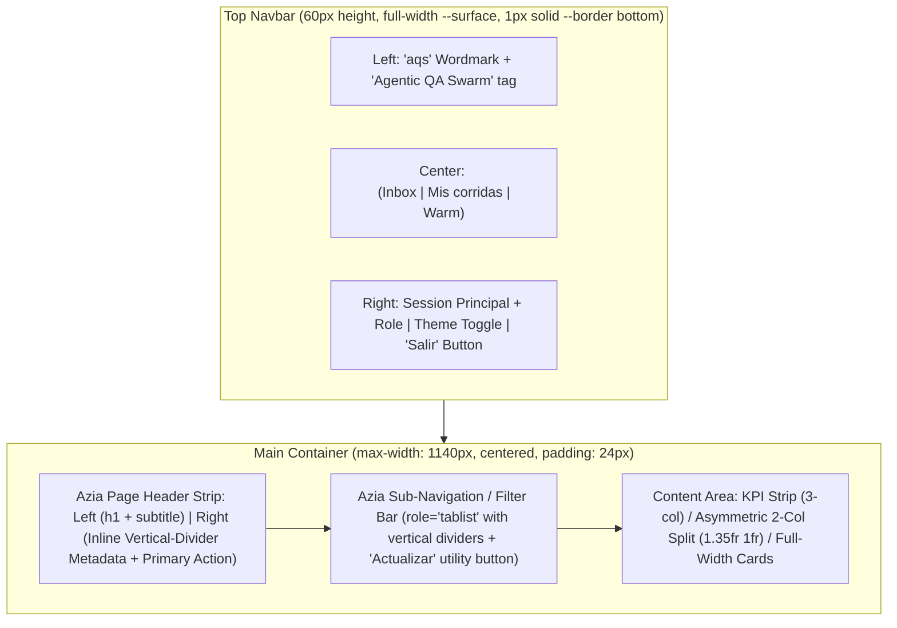

# Agentic QA Swarm — UI/UX Design System & Style Guide (`DESIGN.md`)

> **Authoritative Visual Reference:** [`mockups/swarm-mock.html`](mockups/swarm-mock.html)  
> **Target Implementation:** [`web/dashboard`](web/dashboard) (`U6-T05`, `U6-T06`, `U9-T03`, `U9-T04`)  
> **Aesthetic Direction:** **Azia Operational Analytics** — high-density, flat white surfaces on a cool-gray canvas, crisp `1px solid` wireframe-style borders, horizontal navigation, inline vertical-divider metadata strips, and WCAG AA (≥ 4.5:1) semantic color pairs in both light and dark modes.

---

## 1. Overview & Aesthetic Direction (Azia Style Guide)

### 1.1 Core Philosophy
The **Agentic QA Swarm** dashboard adopts the **Azia Analytics Dashboard** visual language tailored for high-signal engineering and QA operations:

- **Zero Visual Bloat:** No decorative gradients, glassmorphism, floating action buttons, or heavy drop shadows. Depth is communicated via flat white surface cards (`--surface: #ffffff`) over a cool-gray canvas (`--bg: #f8f9fa`) in light mode, or deep slate (`--surface: #161d2b` over `--bg: #0f141f`) in dark mode.
- **Crisp Wireframe Geometry:** All cards, tables, modals, and panels use `1px solid var(--border)` borders (`#cdd4e0` light / `#2d3a52` dark) with minimal border radii (`--radius: 4px`, `--radius-sm: 2px`) and a subtle structural shadow (`--shadow`).
- **Horizontal-First Navigation (No Left Sidebar):** A single `60px` top navigation bar houses the brand wordmark (`aqs`), primary route links (`Inbox`, `Mis corridas`, `Warm`), active session context (`principal_id` + `role`), theme toggle, and logout action (`Salir`).
- **Purposeful Semantic Accents:** Color is reserved strictly for interactive affordances and operational states:
  - **Indigo-Purple (`#5b47fb` / `--accent`):** Primary CTAs, active navigation indicators, and focus rings.
  - **Royal Blue (`#0052cc` / `--info`):** Active execution phases (`actual`), informational badges (`invariant_probe`), and trace links.
  - **Cyan-Teal (`#00666e` / `--teal`):** Confirmed notifications, HTTP `GET` badges, and baseline metadata.
  - **Emerald (`#0a7b3e` / `--ok`):** Completed phases (`hecha`), `sin-hallazgos` verdict, `ready` warm state, and `2xx` status expectations.
  - **Amber (`#8a5000` / `--warn`):** Pending confirmations (`pending`), `inconcluso` verdict, `dirty` / `cuarentena` warm states, and rate-limit (`429`) / retryable warnings.
  - **Crimson (`#b81d2c` / `--danger`):** Confirmed logic bugs (`bug`), terminal `failed` run state, `rejected` notifications, and `401`/`403`/`5xx` alerts.

### 1.2 MVP Scope Alignment (5 Real Views Only)
This design system governs the **5 real MVP/demo routes** implemented in `web/dashboard` across units `U6` and `U9`:

| # | Route | Component | Primary Responsibility |
|---|---|---|---|
| 1 | `/login` | [`LoginPage.tsx`](web/dashboard/src/pages/Login/LoginPage.tsx) | Local authentication (`usuario`, `clave`), optional TOTP (`codigo`), and error handling (`401`, `429` countdown, `503`). |
| 2 | `/inbox` | [`InboxPage.tsx`](web/dashboard/src/pages/Inbox/InboxPage.tsx) | Default route (`/` redirects to `/inbox`). Lists deployment notifications by state (`Pendientes`, `Confirmadas`, `Rechazadas`), inspects artifact metadata, and opens the human confirmation dialog (`Confirmar corrida`). |
| 3 | `/runs/:id` | [`RunPage.tsx`](web/dashboard/src/pages/Run/RunPage.tsx) | Live 9-phase run timeline (`confirmed` → `done` or `failed`), final verdict badge (`bug`, `sin-hallazgos`, `inconcluso`), single-fetch post-mortem report (`GET /api/reports/{run}`), and collapsible `FlowPlan` (`GET /api/runs/{id}/plan`). |
| 4 | `/runs` | [`RunsPage.tsx`](web/dashboard/src/pages/Runs/RunsPage.tsx) | «Mis corridas» audit table listing `ConfirmationReceipt` records (`run_id`, `notification_id`, `confirmed_at`, `confirmed_by`). |
| 5 | `/warm` | [`WarmPage.tsx`](web/dashboard/src/pages/Warm/WarmPage.tsx) | «Entorno warm» operational status card (`ready`, `dirty`, `cuarentena`, `idle-escalado`), `reset_verified` check, `baseline_version`, `warm_id`, and unverified-reset alert banner. |

### 1.3 Non-MVP Elements Explicitly Excluded
To keep the UI strictly faithful to the "Agent (no Autonomous)" MVP architecture and prevent scope creep in `U9-T04`, the following elements **must not** appear in the dashboard:
- **No left sidebar** or collapsible drawer navigation.
- **No multi-project / multi-tenant switcher** (MVP operates on a single configured target repository/environment).
- **No autonomous/auto-run toggles** (human confirmation in `/inbox` is a non-negotiable invariant).
- **No inline k6 load-testing script generator** or performance chart widgets.
- **No Slack/webhook notification preview widgets** inside the web UI.
- **No separate Settings, Users, or standalone Audit routes** beyond `/runs` («Mis corridas»).

---

## 2. Design Tokens & Color System (WCAG AA ≥ 4.5:1 Verified)

### 2.1 Authoritative CSS Custom Properties
All colors, surfaces, borders, radii, shadows, and typography stacks are declared in a single stylesheet (`web/dashboard/src/styles.css` or `web/dashboard/src/styles/tokens.css`). Dark mode activates automatically via `@media (prefers-color-scheme: dark)` and can also be forced via `:root[data-theme="dark"]` (while `:root[data-theme="light"]` forces light mode).

```css
:root,
:root[data-theme="light"] {
  --bg: #f8f9fa;
  --surface: #ffffff;
  --surface-2: #f1f4f8;
  --surface-3: #e5e9f2;
  --border: #cdd4e0;
  --border-subtle: #e2e8f0;
  --text: #1c273c;
  --text-muted: #505d73;
  --text-faint: #596882;
  --accent: #5b47fb;
  --accent-hover: #4632e0;
  --accent-soft: #eeecfe;
  --accent-text: #3e2adb;
  --ok: #0a7b3e;
  --ok-soft: #e3f7ec;
  --warn: #8a5000;
  --warn-soft: #fef3dc;
  --danger: #b81d2c;
  --danger-soft: #fde8ea;
  --info: #0052cc;
  --info-soft: #e6f0ff;
  --teal: #00666e;
  --teal-soft: #e0f7f9;
  --radius: 4px;
  --radius-sm: 2px;
  --shadow: 0 1px 2px rgba(28, 39, 60, 0.04);
  --font-sans: "IBM Plex Sans", -apple-system, BlinkMacSystemFont, "Segoe UI", Roboto, sans-serif;
  --font-mono: "IBM Plex Mono", ui-monospace, SFMono-Regular, Menlo, Consolas, monospace;
  color-scheme: light;
}

@media (prefers-color-scheme: dark) {
  :root:not([data-theme="light"]) {
    --bg: #0f141f;
    --surface: #161d2b;
    --surface-2: #1e2738;
    --surface-3: #283347;
    --border: #2d3a52;
    --border-subtle: #222c3f;
    --text: #f0f4f8;
    --text-muted: #a8b6cc;
    --text-faint: #8f9fb8;
    --accent: #5b47fb;
    --accent-hover: #6e5cff;
    --accent-soft: #211d47;
    --accent-text: #a89eff;
    --ok: #42d992;
    --ok-soft: #102e22;
    --warn: #f7b749;
    --warn-soft: #33240d;
    --danger: #ff7a85;
    --danger-soft: #38151b;
    --info: #75adff;
    --info-soft: #132747;
    --teal: #3ce0eb;
    --teal-soft: #0e2d33;
    --shadow: 0 1px 3px rgba(0, 0, 0, 0.35);
    color-scheme: dark;
  }
}

:root[data-theme="dark"] {
  --bg: #0f141f;
  --surface: #161d2b;
  --surface-2: #1e2738;
  --surface-3: #283347;
  --border: #2d3a52;
  --border-subtle: #222c3f;
  --text: #f0f4f8;
  --text-muted: #a8b6cc;
  --text-faint: #8f9fb8;
  --accent: #5b47fb;
  --accent-hover: #6e5cff;
  --accent-soft: #211d47;
  --accent-text: #a89eff;
  --ok: #42d992;
  --ok-soft: #102e22;
  --warn: #f7b749;
  --warn-soft: #33240d;
  --danger: #ff7a85;
  --danger-soft: #38151b;
  --info: #75adff;
  --info-soft: #132747;
  --teal: #3ce0eb;
  --teal-soft: #0e2d33;
  --shadow: 0 1px 3px rgba(0, 0, 0, 0.35);
  color-scheme: dark;
}
```

### 2.2 WCAG AA Contrast Verification Table (`U9-T04` CA-3)
Every declared text/background and badge/background token pair satisfies **WCAG 2.1 AA normal text contrast (≥ 4.5:1)** in both Light and Dark themes. The automated test in `npx vitest run src/styles` parses the CSS variables directly and verifies these pairs without requiring a browser:

| Semantic Pair / UI Role | Foreground Token | Background Token | Light Hex Pair | Light Contrast | Dark Hex Pair | Dark Contrast | Status |
|---|---|---|---|---|---|---|---|
| Primary text on card | `--text` | `--surface` | `#1c273c` / `#ffffff` | **14.89:1** | `#f0f4f8` / `#161d2b` | **15.26:1** | PASS (AAA) |
| Primary text on page canvas | `--text` | `--bg` | `#1c273c` / `#f8f9fa` | **14.23:1** | `#f0f4f8` / `#0f141f` | **16.57:1** | PASS (AAA) |
| Primary text on secondary surface | `--text` | `--surface-2` | `#1c273c` / `#f1f4f8` | **13.50:1** | `#f0f4f8` / `#1e2738` | **13.71:1** | PASS (AAA) |
| Muted text on card | `--text-muted` | `--surface` | `#505d73` / `#ffffff` | **6.75:1** | `#a8b6cc` / `#161d2b` | **8.18:1** | PASS (AA) |
| Muted text on secondary surface | `--text-muted` | `--surface-2` | `#505d73` / `#f1f4f8` | **6.12:1** | `#a8b6cc` / `#1e2738` | **7.35:1** | PASS (AA) |
| Faint metadata / table headers on card | `--text-faint` | `--surface` | `#596882` / `#ffffff` | **5.77:1** | `#8f9fb8` / `#161d2b` | **6.32:1** | PASS (AA) |
| Faint metadata on secondary surface | `--text-faint` | `--surface-2` | `#596882` / `#f1f4f8` | **5.23:1** | `#8f9fb8` / `#1e2738` | **5.68:1** | PASS (AA) |
| Primary button label on accent | `#ffffff` | `--accent` | `#ffffff` / `#5b47fb` | **5.50:1** | `#ffffff` / `#5b47fb` | **5.50:1** | PASS (AA) |
| Accent text on accent-soft badge | `--accent-text` | `--accent-soft` | `#3e2adb` / `#eeecfe` | **7.31:1** | `#a89eff` / `#211d47` | **6.80:1** | PASS (AA) |
| Accent text on card surface | `--accent-text` | `--surface` | `#3e2adb` / `#ffffff` | **8.33:1** | `#a89eff` / `#161d2b` | **7.56:1** | PASS (AA) |
| OK badge (`sin-hallazgos`, `ready`, `hecha`) | `--ok` | `--ok-soft` | `#0a7b3e` / `#e3f7ec` | **4.91:1** | `#42d992` / `#102e22` | **8.22:1** | PASS (AA) |
| OK text on card surface | `--ok` | `--surface` | `#0a7b3e` / `#ffffff` | **5.41:1** | `#42d992` / `#161d2b` | **9.55:1** | PASS (AA) |
| Warn badge (`inconcluso`, `dirty`, `cuarentena`, `pending`) | `--warn` | `--warn-soft` | `#8a5000` / `#fef3dc` | **5.58:1** | `#f7b749` / `#33240d` | **8.54:1** | PASS (AA) |
| Warn text on card surface | `--warn` | `--surface` | `#8a5000` / `#ffffff` | **6.10:1** | `#f7b749` / `#161d2b` | **9.77:1** | PASS (AA) |
| Danger badge (`bug`, `failed`, `rejected`, alerts) | `--danger` | `--danger-soft` | `#b81d2c` / `#fde8ea` | **5.40:1** | `#ff7a85` / `#38151b` | **6.52:1** | PASS (AA) |
| Danger text on card surface | `--danger` | `--surface` | `#b81d2c` / `#ffffff` | **6.29:1** | `#ff7a85` / `#161d2b` | **6.94:1** | PASS (AA) |
| Info badge (`actual` phase, `invariant_probe`) | `--info` | `--info-soft` | `#0052cc` / `#e6f0ff` | **6.12:1** | `#75adff` / `#132747` | **6.83:1** | PASS (AA) |
| Teal badge (`confirmed`, HTTP `GET`) | `--teal` | `--teal-soft` | `#00666e` / `#e0f7f9` | **5.79:1** | `#3ce0eb` / `#0e2d33` | **9.38:1** | PASS (AA) |

---

## 3. Typography & CSP-Safe Font Stack

### 3.1 CSP Constraint: Zero External Font CDNs (`U6-T06` & `U9-T04` CA-2)
The production build of `web/dashboard` enforces a strict Content Security Policy in `index.html`:

```text
default-src 'self'; script-src 'self'; style-src 'self'; img-src 'self' data:; connect-src 'self'; object-src 'none'; base-uri 'self'; frame-ancestors 'none'
```

Furthermore, `U9-T04` CA-2 runs an automated check verifying that **zero** external `http://` or `https://` URLs (outside standard XML/SVG `w3.org` namespaces) exist anywhere in `dist/`. Therefore:
- **FORBIDDEN:** `<link href="https://fonts.googleapis.com/...">` or `@import url("https://...")`.
- **REQUIRED:** Either bundle local `@font-face` WOFF2 files under `public/fonts/` or `src/assets/fonts/` referenced via relative paths, or rely directly on the local/system fallback stack defined below.

### 3.2 Font Stacks
- **Sans-Serif (`--font-sans`):**
  ```css
  --font-sans: "IBM Plex Sans", -apple-system, BlinkMacSystemFont, "Segoe UI", Roboto, sans-serif;
  ```
- **Monospace (`--font-mono`):** Used for commit SHAs (`7` chars), `run_id`, `trace_id`, `notification_id`, `warm_id`, `baseline_version`, HTTP paths, S3 evidence URIs (`s3://...`), and JSON payloads in `<pre>`.
  ```css
  --font-mono: "IBM Plex Mono", ui-monospace, SFMono-Regular, Menlo, Consolas, monospace;
  ```

### 3.3 Type Scale & Hierarchy

| Element / Role | CSS Selector / Element | Font Family | Size | Weight | Line Height | Letter Spacing / Case | Color Token |
|---|---|---|---|---|---|---|---|
| **Brand Wordmark** | `.azia-logo` | `--font-sans` | `22px` (`1.375rem`) | `800` | `1.0` | `-0.04em`, lowercase `aqs` | `--accent-text` (`--accent` dot) |
| **Page Title** | `h1`, `.azia-page-title h1` | `--font-sans` | `22px` (`1.375rem`) | `700` | `1.5` (mockup; decisión U10-T06) | `-0.02em` | `--text` |
| **KPI Metric Value** | `.kpi-value` | `--font-sans` | `24px–28px` | `700` | `1.15` | `-0.02em`, `tabular-nums` | `--text` (or semantic token) |
| **Card / Section Title** | `h2`, `.card-title` | `--font-sans` | `14px` (`0.875rem`) | `700` | `1.5` (mockup; decisión U10-T06) | `-0.01em` | `--text` |
| **Body / Table Cell** | `body`, `td`, `dd`, `p` | `--font-sans` | `13px` (`0.8125rem`) | `400` | `1.5` | `normal` | `--text` |
| **Secondary / Subtitle** | `.card-subtitle`, `.text-muted` | `--font-sans` | `12px–13px` | `400` | `1.45` | `normal` | `--text-muted` |
| **Metadata / Table Header** | `th`, `dt`, `.meta-label`, `.kpi-label` | `--font-sans` | `10px–11px` | `600–700` | `1.2` | `0.06em`, `uppercase` | `--text-faint` |
| **Monospace Identifier / Code** | `code`, `pre`, `.mono` | `--font-mono` | `12px` (`0.75rem`) | `500` | `1.45` | `normal` | `--text` on `--surface-2` |

---

## 4. Layout Architecture & Azia Structural Patterns



### 4.1 Top Navbar (`60px` height)
- **Outer wrapper (`.azia-header`):** `background: var(--surface)`, `border-bottom: 1px solid var(--border)`, sticky at `top: 0` (`z-index: 40`).
- **Inner container (`.azia-header-inner`):** `max-width: 1140px`, `margin: 0 auto`, `padding: 0 24px`, `min-height: 60px`, `display: flex`, `align-items: center`, `justify-content: space-between`, `gap: 20px`.
- **Left (`.azia-brand`):**
  - Lowercase `aqs` wordmark (`22px`, `font-weight: 800`, `color: var(--accent-text)`) with a trailing period in `var(--accent)`.
  - Vertical divider (`border-left: 1px solid var(--border)`, `padding-left: 10px`) + `Agentic QA Swarm` subtitle (`11px`, `font-weight: 600`, `color: var(--text-muted)`).
- **Center (`<nav aria-label="Principal" className="azia-nav">`):**
  - Horizontal list of `<NavLink>` items for `/inbox` (`Inbox`), `/runs` (`Mis corridas`), and `/warm` (`Warm`).
  - Each link (`height: 60px`, `padding: 0 14px`) includes a `15px × 15px` stroke SVG icon (`aria-hidden="true"`) + label.
  - Active route (`aria-current="page"` / `.active`) displays `color: var(--accent-text)` and a `2px solid var(--accent)` bottom bar (`margin-bottom: -1px`).
- **Right (`.azia-header-right`):**
  - Displays authenticated user identity (`session.principal_id` and `session.role` in parentheses, e.g., `qa-lead (confirmador)`).
  - Theme switch button and secondary `<button type="button">Salir</button>`.

### 4.2 Page Header Strip (`.azia-page-header`)
- Positioned at the top of `<main>` with `display: flex; justify-content: space-between; align-items: flex-end; flex-wrap: wrap; gap: 16px; margin-bottom: 20px`.
- **Left (`.azia-page-title`):** `<h1>` page title (`22px`, `font-weight: 700`) + `<p>` concise operational description (`13px`, `color: var(--text-muted)`).
- **Right (`.azia-meta-strip`):** Azia's signature inline metadata blocks separated by `1px solid var(--border-subtle)` vertical dividers (`padding-right: 18px`):
  - Top line (`.meta-label`): `10px`, uppercase, `letter-spacing: 0.06em`, `color: var(--text-faint)`.
  - Bottom line (`.meta-value`): `13px`, `font-weight: 700`, `color: var(--text)`.
  - Optional trailing rectangular CTA button (`Actualizar` or action trigger).

### 4.3 Sub-Navigation / Filter Bar (`.azia-subnav`)
- Used in `/inbox` to switch notification filter states (`Pendientes`, `Confirmadas`, `Rechazadas`) and house the `Actualizar` button.
- Full-width `border-bottom: 1px solid var(--border)` with `padding-bottom: 10px; margin-bottom: 20px; display: flex; justify-content: space-between; align-items: center; flex-wrap: wrap; gap: 12px`.
- Left tab group (`role="tablist"`): tabs separated by `1px solid var(--border-subtle)` vertical lines (`padding: 4px 12px`). Active tab (`aria-selected="true"`) uses `color: var(--accent-text); font-weight: 700; background: var(--accent-soft); border-radius: var(--radius-sm)`.

### 4.4 Card Grid & Responsive Breakpoints (`375px` Mobile Requirement)
- **Desktop (`> 920px`):**
  - Container `max-width: 1140px; padding: 24px`.
  - `.grid-3`: `grid-template-columns: repeat(3, minmax(0, 1fr)); gap: 16px` (KPI summary strip).
  - `.grid-2-asym`: `grid-template-columns: 1.35fr 1fr; gap: 16px` (Inbox table + detail panel, or Run report + FlowPlan).
  - `.grid-2`: `grid-template-columns: repeat(2, minmax(0, 1fr)); gap: 16px`.
- **Tablet (`≤ 920px`):**
  - `.grid-3`, `.grid-2-asym`, and `.grid-2` collapse to `grid-template-columns: 1fr`.
- **Mobile (`≤ 640px`, verified down to `375px` viewport width per `U9-T04` CA-4):**
  - `html, body { overflow-x: hidden; max-width: 100%; }` prevents any page-level horizontal scrollbar at `375px`.
  - `.azia-header-inner` wraps cleanly (`padding: 8px 12px; height: auto`), with `<nav aria-label="Principal">` taking a full row (`order: 3; width: 100%; border-top: 1px solid var(--border-subtle)`) and compact link padding (`height: 42px; padding: 0 10px; font-size: 12px`).
  - `.azia-main` reduces padding to `16px 12px 32px`.
  - All data tables sit inside `.table-wrap { width: 100%; overflow-x: auto; -webkit-overflow-scrolling: touch; }` so wide tables scroll internally within their card without pushing the viewport wider than `375px`.
  - `<dl>` definition lists switch from 2-column (`150px 1fr`) to stacked `1fr` rows with `overflow-wrap: anywhere` for long `s3://` URIs and container digests.

---

## 5. Component & Screen Specifications (Mapping 1:1 to `web/dashboard`)

> [!IMPORTANT]
> **Behavioral & Test Compatibility Contract (`U9-T04` CA-1):**  
> Every screen specification below preserves the exact ARIA roles, labels, button texts, input IDs, and `data-*` attributes asserted by the existing Vitest test suite (`src/**/*.test.tsx`).

### 5.1 `/login` — `LoginPage.tsx`
- **Layout:** Centered single-column authentication card (`.login-wrap { max-width: 400px; margin: 48px auto; }`) inside `<main>`.
- **Header:** Brand badge (`aqs. Agentic QA Swarm`), `<h1>Iniciar sesión</h1>`, and subtitle explaining human confirmation access.
- **Form (`<form noValidate>`):**
  - **Usuario field:** `<label htmlFor="login-usuario">Usuario</label>` + `<input id="login-usuario" name="username" type="text" autoComplete="username" required />`.
  - **Clave field:** `<label htmlFor="login-clave">Clave</label>` + `<input id="login-clave" name="password" type="password" autoComplete="current-password" required />`.
  - **2FA Toggle & Conditional Field:**
    - When collapsed: secondary toggle button `<button type="button" className="btn btn-secondary">Tengo un código de verificación</button>`.
    - When expanded: `<label htmlFor="login-codigo">Código de verificación (opcional)</label>` + `<input id="login-codigo" name="totp" type="text" inputMode="numeric" autoComplete="one-time-code" />`.
  - **Submit Button:** Full-width primary button `<button type="submit" className="btn btn-primary">Entrar</button>` (shows `Verificando…` while `enviando` is true).
- **Alert Banners (`<div role="alert" className="alert alert-danger | alert-warn">`):**
  - `401`: «Credenciales inválidas. Verifique usuario, clave y código.» (`.alert-danger`).
  - `429`: «Demasiados intentos. Reintente en {reintentarEn} s.» with disabled submit button during countdown (`.alert-warn`).
  - `503`: «Servicio de autenticación no disponible. Intente más tarde.» (`.alert-danger`).
  - Network/other error: «No se pudo contactar al servidor. Intente más tarde.» (`.alert-danger`).

### 5.2 `/inbox` — `InboxPage.tsx` (Default Route `/` → `/inbox`)
- **Heading & Controls:**
  - `<h1>Inbox de notificaciones</h1>`
  - Sub-navigation bar (`.azia-subnav`):
    - `<div role="tablist" aria-label="Filtrar por estado">` containing 3 `<button role="tab" aria-selected={...}>` buttons:
      - `Pendientes` (`state = "pending"`)
      - `Confirmadas` (`state = "confirmed"`)
      - `Rechazadas` (`state = "rejected"`)
    - `<button type="button" className="btn btn-secondary">Actualizar</button>`
- **Notifications Table (`.table-wrap > table`):**
  - Columns (`<thead>`): `Repositorio`, `Evento`, `SHA`, `Artefacto`, `Estado`, `Acciones`.
  - Row cells (`<tbody>`):
    - `n.repo` (`font-weight: 600`)
    - `n.event_type`
    - `<code className="mono">{n.commit_sha.slice(0, 7)}</code>`
    - `n.artifact_Status` (`ready` badge in `.badge-ok`, `failed` in `.badge-danger`, `pending` in `.badge-warn`)
    - Estado badge (`pending` → `.badge-warn`, `confirmed` → `.badge-teal`, `rejected` → `.badge-danger`)
    - Action button: `<button type="button" className="btn btn-secondary btn-sm">Ver detalle</button>`
- **Detail Panel (`<section aria-label="Detalle de la notificación" className="card">`):**
  - Header: `<h2>Detalle</h2>` + notification ID badge.
  - Definition list (`<dl className="dl-grid">`): `ID`, `Repositorio`, `Rama`, `SHA` (`<code>`), `Imagen` (`<code>`), `Digest` (`<code>`), `Estado`.
  - Primary CTA (only when `seleccionada.state === "pending"`):
    - `<button type="button" className="btn btn-primary" disabled={seleccionada.artifact_Status !== "ready"}>Revisar y confirmar</button>`
    - If `artifact_Status !== "ready"`, displays muted warning: «El artefacto aún no está listo para confirmar (`{artifact_Status}`).»
- **Confirmation Modal (`<div role="dialog" aria-modal="true" aria-labelledby="modal-confirmar-titulo" className="modal-backdrop">`):**
  - Inner card (`.modal-card`):
    - `<h2 id="modal-confirmar-titulo">Confirmar corrida</h2>`
    - Summary text with `repo`, 7-char `commit_sha`, and `<code className="mono">{image_digest}</code>`.
    - `<fieldset>` with `<legend>Familias de flujos a ejecutar</legend>` and checkbox labels for `FLOW_FAMILIES` (`happy-path`).
    - Validation/API error banner (`<div role="alert" className="alert alert-danger">`) if zero families are selected or if `409` / `5xx` occurs.
    - Footer actions (`.modal-actions`): `<button type="button" className="btn btn-primary">Confirmar</button>` and `<button type="button" className="btn btn-secondary">Cancelar</button>`.

### 5.3 `/runs/:id` — `RunPage.tsx` (Corrida, Veredicto, Post-Mortem & Plan)
- **Header & Verdict Strip:**
  - `<h1>Corrida {run_id}</h1>`
  - Metadata strip (`<dl>`): `Estado` (`run.status`), `Notificación` (`run.notification_id`), `Traza` (`<code className="mono">{run.trace_id}</code>`), and conditional `Veredicto` when `run.verdict` is present.
  - **Verdict Badge (`data-veredicto={run.verdict}`):** Never relies on color alone; always renders explicit Spanish text + distinct semantic badge class:
    - `bug` → `<span data-veredicto="bug" className="badge badge-danger">Veredicto: bug confirmado</span>`
    - `sin-hallazgos` → `<span data-veredicto="sin-hallazgos" className="badge badge-ok">Veredicto: sin hallazgos</span>`
    - `inconcluso` → `<span data-veredicto="inconcluso" className="badge badge-warn">Veredicto: inconcluso</span>`
- **9-Phase Execution Timeline (`<ol aria-label="Fases de la corrida" className="phase-timeline">`):**
  - Renders the 9 canonical phases in order:
    1. `confirmed` («Confirmada»)
    2. `warm_ready` («Warm listo»)
    3. `deploying` («Desplegando»)
    4. `inferring` («Infiriendo superficie»)
    5. `rehearsing` («Ensayando flujos»)
    6. `running` («Ejecutando flujos»)
    7. `resetting` («Restaurando warm»)
    8. `reporting` («Generando informe»)
    9. `done` («Terminada»)
  - Each `<li data-fase={f.id} data-fase-estado={estado} aria-current={estado === "actual" ? "step" : undefined}>` shows both the phase label and the explicit state tag `(hecha)`, `(actual)`, or `(pendiente)`:
    - `data-fase-estado="hecha"`: Emerald left border (`3px solid var(--ok)`), subtle `--ok-soft` tint, check indicator.
    - `data-fase-estado="actual"`: Royal blue border (`1px solid var(--info)` + `3px solid var(--info)` left bar), `--info-soft` background, pulsing dot (disabled under `prefers-reduced-motion: reduce`).
    - `data-fase-estado="pendiente"`: Neutral `--surface` background, `--border` outline, muted text.
  - **Terminal `failed` state:** When `run.status === "failed"`, all 9 phase items mark `data-fase-estado="pendiente"` and a prominent status banner `<p role="status" data-estado="failed" className="alert alert-danger">Estado de la corrida: fallida (failed)</p>` is displayed below the timeline.
- **Post-Mortem Report Section (`<section aria-label="Informe post-mortem" className="card">`):**
  - Triggered **once** when `run.status === "done"` or when `run.status === "failed"` with a non-empty `run.report_uri`.
  - Heading: `<h2>Informe post-mortem</h2>`
  - **Loaded state:**
    - Executive summary block (`<p className="report-summary">{reporte.summary}</p>`), rendered strictly as plain React text nodes (never `dangerouslySetInnerHTML`).
    - Empty findings (`reporte.findings.length === 0`): `<p className="empty-state">No se registraron hallazgos en esta corrida.</p>`.
    - Findings list (`<ul aria-label="Hallazgos del informe" className="findings-list">`): Each finding (`<li className="finding-card">`) features a `3px solid var(--danger)` left accent bar and displays:
      - Endpoint header: `<code className="http-badge">{h.method} {h.path}</code>`
      - `<dl className="dl-grid">` with `Invariante` (`h.invariant`), `Causa raíz` (`h.root_cause`), and `Evidencia` (`<ul>` of `<li><code className="mono">{uri}</code></li>` for copyable `s3://...` URIs, never `<a href>`).
  - **Error / Retry states (`role="alert"`):**
    - `404 report_not_ready`: «El informe aún no está disponible.» + `<button type="button">Reintentar</button>`.
    - `403` / `404`: «Sin acceso al informe.»
    - `5xx` / network: «No se pudo cargar el informe post-mortem.» + `<button type="button">Reintentar</button>`.
- **Inspectable FlowPlan (`<details className="card plan-details">`):**
  - Triggered **once** when the run reaches `rehearsing`, `running`, `resetting`, `reporting`, `done`, or `failed`.
  - `<summary className="plan-summary">Flujos ejecutados</summary>`
  - **Loaded state:**
    - Displays `Workflow: {plan.workflow}` metadata line.
    - `<ul aria-label="Lista de flujos" className="flow-list">` where each flow item shows:
      - Flow title (`<strong>{flujo.name}</strong>`), ` — familia {flujo.invariant}` (if present), and ` (sonda de invariante)` badge when `flujo.invariant_probe` is true.
      - Ordered steps (`<ol className="step-list">`): each step renders `<code className="http-badge">{paso.method} {paso.path}</code>`, optional ` → {paso.expect_status}`, and (if `paso.body !== undefined`) a formatted JSON block `<pre className="code-block">{JSON.stringify(paso.body, null, 2)}</pre>`.
  - **Not-ready state:** `404 plan_not_ready` renders `<p>Plan aún no disponible.</p>`.

### 5.4 `/runs` — `RunsPage.tsx` («Mis corridas»)
- **Header:** `<h1>Mis corridas</h1>` + subtitle explaining the human confirmation audit trail.
- **Table Card (`.card > .table-wrap > table`):**
  - Columns (`<thead>`): `Corrida`, `Notificación`, `Confirmada`, `Por`.
  - Rows (`<tbody>`):
    - `<Link to={"/runs/" + c.run_id} className="mono-link">{c.run_id}</Link>`
    - `<code className="mono">{c.notification_id}</code>`
    - `<span className="tabular-nums">{c.confirmed_at}</span>`
    - `<span className="badge badge-neutral">{c.confirmed_by}</span>`
  - Empty state: «Aún no has confirmado corridas en esta sesión.»

### 5.5 `/warm` — `WarmPage.tsx` («Entorno warm»)
- **Header:** `<h1>Entorno warm</h1>` + `<button type="button" className="btn btn-secondary">Actualizar</button>`.
- **Warm Status Card (`<section aria-label="Tarjeta del warm" className="card">`):**
  - Distinct state badge (`<p data-warm-state={datos.state}>Estado: <strong>{ETIQUETA_ESTADO[datos.state]}</strong></p>`):
    - `ready` → «Listo» (`.badge-ok`, emerald `--ok` on `--ok-soft`)
    - `dirty` → «Sucio (requiere reset)» (`.badge-warn`, amber `--warn` on `--warn-soft`)
    - `cuarentena` → «En cuarentena» (`.badge-danger`, crimson `--danger` on `--danger-soft`)
    - `idle-escalado` → «Inactivo (escalado)» (`.badge-info`, blue `--info` on `--info-soft`)
  - Definition list (`<dl className="dl-grid">`):
    - `Reset verificado`: `sí` (`.badge-ok`) or `no` (`.badge-warn`)
    - `Versión base`: `<code className="mono">{datos.baseline_version ?? "—"}</code>`
    - `ID warm`: `<code className="mono">{datos.warm_id ?? "—"}</code>`
    - Conditional `Motivo`: `{datos.reason}`
  - **Safety Invariant Warning (`role="alert"`):** When `datos.state === "ready" && !datos.reset_verified`, renders `<div role="alert" className="alert alert-warn">Atención: el entorno figura como listo pero el último reset no está verificado.</div>`.

---

## 6. Guardrails for Implementation (`U9-T04`)

1. **Plain CSS Only (Zero New Dependencies):**
   - Implement all styling in `web/dashboard/src/styles.css` (and optional modular CSS imports under `src/styles/`).
   - Do **not** install Tailwind, shadcn/ui, Emotion, styled-components, or icon libraries. Use lightweight inline SVG icons (`aria-hidden="true"`) or pure CSS indicators where appropriate.
2. **Strict CSP Compliance (`style-src 'self'`):**
   - Never use React `style={{ ... }}` inline style props on DOM elements or inject `<style>` tags at runtime, as `dist/index.html` prohibits `'unsafe-inline'`.
   - Never reference external URLs (`https://fonts.googleapis.com`, external avatars, or CDN scripts).
3. **Motion & Accessibility (`prefers-reduced-motion`):**
   - Keep transitions short (`120ms ease` for hover/focus states).
   - Always include a `@media (prefers-reduced-motion: reduce)` block that disables animations and transitions:
     ```css
     @media (prefers-reduced-motion: reduce) {
       *,
       *::before,
       *::after {
         animation-duration: 0.01ms !important;
         animation-iteration-count: 1 !important;
         transition-duration: 0.01ms !important;
         scroll-behavior: auto !important;
       }
     }
     ```
4. **Visible Focus & Form Accessibility:**
   - Every interactive control (`button`, `a`, `input`, `summary`, `[role="tab"]`) must display a clear `:focus-visible` ring (`outline: 2px solid var(--accent); outline-offset: 2px`).
   - Every form input must remain paired with an explicit visible `<label htmlFor="...">`.
5. **Preserve All Existing Behavioral Tests (`src/**/*.test.tsx`):**
   - Do not alter the behavioral expectations of any test in `web/dashboard/src/**/*.test.tsx`.
   - Maintain all semantic landmarks (`<nav aria-label="Principal">`, `<section aria-label="Detalle de la notificación">`, `<section aria-label="Tarjeta del warm">`, `<section aria-label="Informe post-mortem">`, `<ol aria-label="Fases de la corrida">`) and `data-*` attributes (`data-fase`, `data-fase-estado`, `data-veredicto`, `data-estado`, `data-warm-state`).
