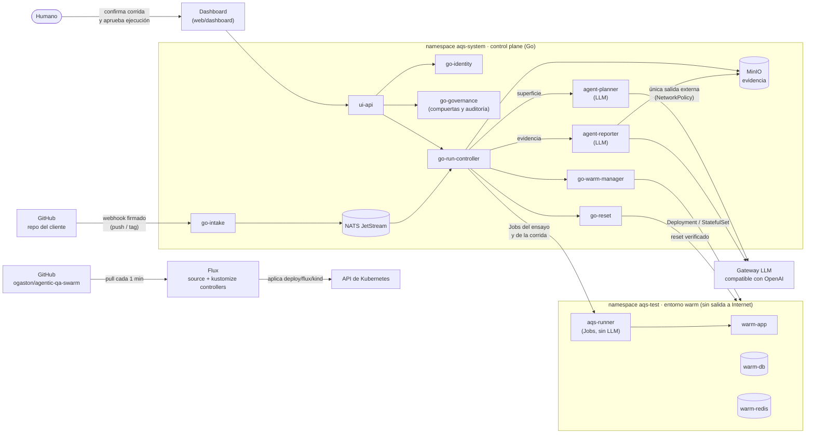

# Agentic QA Swarm

Grupo: Omar Gaston | Fecha de presentación: sábado 21 de noviembre de 2026 (sesión 16)

QA de caja negra disparado por GitHub, ejecutado en un entorno aislado propio de la plataforma y nunca contra el
staging del cliente. **GitHub notifica, un humano confirma, el sandbox ejecuta, el humano lee el reporte.**

| Documento | Para qué |
|---|---|
| [`docs/pvd.md`](docs/pvd.md) | Visión del producto (módulo 2) |
| [`specs/prd.md`](specs/prd.md) | PRD autoritativo (módulo 3) |
| [`unidades-y-tareas.md`](unidades-y-tareas.md) + [`tareas/`](tareas/) | Unidades, grafo y una especificación por tarea (módulo 5) |
| [`.claude/agents/`](.claude/agents/) | El loop orquestador, codificador y revisor (módulo 6) |
| [`deploy/flux/`](deploy/flux/) | GitOps con Flux (módulo 8) |
| [`docs/entrega/evidencia-2026-11-02.md`](docs/entrega/evidencia-2026-11-02.md) | Salidas reales que respaldan este README |

---

## 1. Problema

**Usuario.** Equipos de plataforma o backend de 3 a 15 ingenieros en scale-ups de 50 a 500 personas (fintech,
e-commerce, logística, SaaS B2B transaccional) que ya usan GitHub y pueden correr su app en Docker. Quien firma
es el VP of Engineering o Head of Platform ([`docs/icp.md`](docs/icp.md)).

**Qué le duele.** Su CI corre en cada PR, pero solo ejecuta lo que el repositorio ya trae (pruebas de caja blanca)
o apunta al staging compartido. Nadie levanta una copia aislada de la app en ejecución, observa lo que expone hacia
afuera y ejercita flujos de negocio como lo haría un QA: autenticarse, crear un recurso, modificarlo en concurrencia,
probar transiciones inválidas. Los fallos caros (condiciones de carrera, invariantes de negocio, *mass assignment*)
no los ve un test unitario ni un escáner estático. La categoría *Broken Object Property Level Authorization* (antes
*Mass Assignment*) está en el OWASP API Security Top 10 2023 ([fuente](https://api-security.owasp.org/editions/2023/en/0xa3-broken-object-property-level-authorization)).

**Cómo lo resuelve hoy.** Escribe y mantiene a mano scripts de k6, Playwright o colecciones de Postman, que se
rompen cuando cambia la superficie, o no lo hace y asume el riesgo en producción. Cuánto le cuesta: **no tenemos
una cifra medida.** El PVB afirma que el 80 % del esfuerzo es plomería de autenticación y setup, pero lo dejó
marcado `[VERIFICAR]` y no lo hemos verificado; no lo usamos como argumento.

**Métrica de éxito.** North Star del PRD: tasa de hallazgos lógicos confirmados por encima del 30 % de las APIs del
beachhead en 90 días (proyección propia, sin clientes todavía). Métricas de confianza: **reset verificado en el
100 % de las corridas**, ensayo que pasa a la primera en más del 70 % de los planes, cero incidentes de límite de
autonomía.

**Qué cambió desde el PVB** ([`DECISIONES.md`](DECISIONES.md)):

- **Del sandbox desechable al entorno warm** (2026-09-17). El PVB destruía el namespace en cada corrida. Lo
  cambiamos por un entorno warm propio de la plataforma, que se reutiliza entre corridas con un **reset
  verificado** (restart, base de datos limpia, caché vaciada, verificación `reset_verified=true`, cuarentena si
  falla). Recorta arranque y costo. Con eso, el riesgo número 1 dejó de ser «basura en el clúster» y pasó a ser
  «contaminación entre corridas», y el KPI «teardown 100 %» pasó a «reset verificado 100 %».
- **El humano también confirma qué familias de flujos ejecutar** (U12): primero confirma la corrida y después, ya
  con el plan ensayado, aprueba la ejecución.

---

## 2. Arquitectura en Kubernetes

### 2.1 Diagrama



Los agentes LLM **no tienen ningún permiso en la API de Kubernetes**. Lo que toca el clúster es código Go
determinista, con RBAC acotado a `aqs-test` y a los namespaces `aqs-w-*` de cada repositorio. Lo que cambia la plataforma entra por Git y lo aplica Flux.

### 2.2 Qué objeto implementa cada pieza

| Pieza | Objeto de Kubernetes | Manifiesto |
|---|---|---|
| Namespaces de los dos planos | `Namespace` (con Pod Security) | [`deploy/flux/base/namespaces.yaml`](deploy/flux/base/namespaces.yaml) |
| Control plane: ui-api, go-intake, go-identity, go-governance, go-run-controller, go-warm-manager, go-reset | `Deployment` + `Service` + `ServiceAccount` propio | [`deploy/flux/base/control-plane.yaml`](deploy/flux/base/control-plane.yaml) |
| Agentes LLM: agent-planner, agent-reporter | `Deployment` + `Service`, SA sin token | [`deploy/flux/base/agents.yaml`](deploy/flux/base/agents.yaml) |
| Bus de eventos | `StatefulSet` NATS + `Job` de inicialización + `NetworkPolicy` | [`deploy/flux/base/nats/`](deploy/flux/base/nats/) |
| Evidencia | `StatefulSet` MinIO + `Job` que crea bucket y usuarios | [`deploy/flux/base/minio/`](deploy/flux/base/minio/) |
| Entorno warm | `Deployment` warm-app y warm-redis, `StatefulSet` warm-db, `ResourceQuota`, `LimitRange` | [`deploy/flux/base/warm.yaml`](deploy/flux/base/warm.yaml) |
| Mantenimiento del warm | `CronJob` housekeeping, idle-check, rebuild | [`deploy/flux/base/warm.yaml`](deploy/flux/base/warm.yaml) |
| Runners del ensayo y de la corrida | `Job` creados por go-run-controller en `aqs-test` | [`services/aqs-runner/`](services/aqs-runner/) |
| RBAC | `Role` `aqs-test-operator` + `RoleBinding` por SA. Única excepción: el `ClusterRole` `warm-provisioner` de go-warm-manager (crea los namespaces `aqs-w-*`), confinado por la `ValidatingAdmissionPolicy` de abajo | [`rbac.yaml`](deploy/flux/base/security/rbac.yaml), [`warm-provisioner.yaml`](deploy/flux/base/security/warm-provisioner.yaml) |
| Aislamiento de red | `NetworkPolicy` default-deny en `aqs-test`; default-deny de ingress en `aqs-system` | [`deploy/flux/base/security/`](deploy/flux/base/security/) |
| Aprovisionamiento por repositorio | `ValidatingAdmissionPolicy` que confina a go-warm-manager a `aqs-w-*` | [`deploy/flux/base/security/warm-provisioner.yaml`](deploy/flux/base/security/warm-provisioner.yaml) |
| GitOps en kind | `GitRepository` + `Kustomization` de Flux | [`deploy/flux/clusters/kind/sync.yaml`](deploy/flux/clusters/kind/sync.yaml) |
| GitOps en dev y prod | Lo mismo, con SOPS + age para los Secrets | [`deploy/flux/clusters/`](deploy/flux/clusters/) |
| Observabilidad (dev y prod) | `HelmRelease` kube-prometheus-stack y Loki, `PrometheusRule`, `ServiceMonitor` | [`deploy/flux/base/observability/`](deploy/flux/base/observability/) |
| Backup de evidencia (dev y prod) | `CronJob` + `PrometheusRule` | [`deploy/flux/base/backup/`](deploy/flux/base/backup/) |

Overlays: `deploy/flux/dev`, `deploy/flux/prod` y `deploy/flux/kind`. El de kind quita observabilidad y backup,
porque kind no trae esos CRDs y el destino del backup es un S3 externo.

### 2.3 Seguridad, con evidencia

Salidas completas en [`docs/entrega/evidencia-2026-11-02.md`](docs/entrega/evidencia-2026-11-02.md).

**RBAC de mínimo privilegio.** La diapositiva principal:

```console
$ kubectl auth can-i --list -n aqs-test --as=system:serviceaccount:aqs-system:agent-planner
Resources                                       Non-Resource URLs   Resource Names   Verbs
selfsubjectreviews.authentication.k8s.io        []                  []               [create]
selfsubjectaccessreviews.authorization.k8s.io   []                  []               [create]
selfsubjectrulesreviews.authorization.k8s.io    []                  []               [create]
clustertrustbundles.certificates.k8s.io         []                  []               [get list watch]
                                                [/api/*] [/healthz] [/version] ...   [get]
```

Solo quedan los permisos de descubrimiento que Kubernetes da a cualquier usuario autenticado. El agente que habla
con el LLM no puede leer, crear ni borrar nada, y además su pod corre con `automountServiceAccountToken: false`:
ni siquiera tiene token. `agent-reporter` da la misma salida.

| Pregunta (`kubectl auth can-i ...`) | Respuesta |
|---|---|
| `create pods -n aqs-test --as=...:agent-planner` | `no` |
| `get secrets -n aqs-system --as=...:agent-reporter` | `no` |
| `patch kustomizations.kustomize.toolkit.fluxcd.io -n flux-system --as=...:agent-planner` | `no` |
| `create jobs -n aqs-test --as=...:go-run-controller` | `yes` (su trabajo) |
| `create jobs -n default --as=...:go-run-controller` | `no` |
| `create pods/exec -n aqs-test --as=...:go-reset` | `no` |
| `get pods -n aqs-test --as=system:serviceaccount:aqs-test:aqs-runner` | `no` |

La matriz completa esperada está en [`docs/seguridad/rbac-matriz.csv`](docs/seguridad/rbac-matriz.csv) (234 filas).
`scripts/ci/rbac-matrix.sh` la verifica en CI contra el build de los overlays, sin clúster, y `kind-smoke.sh` la
verifica contra el clúster (`OK rbac-test-ns-only`).

**Pod Security.** `aqs-system`, `aqs-test` y los `aqs-w-*` que crea go-warm-manager llevan
`enforce=baseline` y `warn/audit=restricted`. Todos los pods actuales cumplen `baseline`. `restricted` queda en
aviso porque varios pods aún no declaran `seccompProfile` (ver §8). Prueba:

```console
$ kubectl run psa-probe -n aqs-test --image=busybox:1.37.0 --dry-run=server --overrides='{..."privileged":true...}'
Error from server (Forbidden): pods "psa-probe" is forbidden: violates PodSecurity "baseline:latest": privileged (container "p" must not set securityContext.privileged=true)
```

Los agentes LLM, NATS y MinIO corren con `runAsNonRoot`, y los agentes, NATS y tres servicios Go con
`readOnlyRootFilesystem`; ui-api, go-intake, go-identity y go-governance aún no declaran ninguno de los dos (§8). Las
políticas Rego de [`policy/`](policy/) (con sus pruebas `*_test.rego`) niegan en CI comodines, `secrets`,
`pods/exec`, escalada, `hostNetwork`/`hostPID`/`hostIPC` en `aqs-test` y todo `ClusterRole` salvo la excepción
acotada de `warm-provisioner`.

**El permiso más ancho, dicho sin rodeos.** go-warm-manager tiene un `ClusterRole` (`warm-provisioner`) para crear
namespaces y sus objetos cuando se registra un repositorio nuevo. RBAC no sabe expresar «solo namespaces que
empiecen por `aqs-w-`», así que esa frontera la pone una `ValidatingAdmissionPolicy`: si el que pide es
go-warm-manager, solo admite namespaces `aqs-w-*` y objetos dentro de `aqs-w-*` o `aqs-test`. Es Go determinista,
no un agente LLM. Detalle por capa en
[`docs/seguridad/aislamiento.md`](docs/seguridad/aislamiento.md).

**Red.** `aqs-test` es default-deny de entrada y salida: los runners alcanzan la app warm y nada más, ni el LLM ni
Internet (`OK netpol-sin-egress-test` en `kind-smoke.sh`). Los agentes solo pueden salir hacia el gateway del LLM
(`OK llm-egress-acotado`).

### 2.4 El bucle GitOps funcionando

En kind, Flux v2.4.0 sigue el repositorio y aplica `deploy/flux/kind` cada minuto
([`scripts/kind/flux-up.sh`](scripts/kind/flux-up.sh)). Prueba real del 2026-11-02:

1. Commit `4d93c97`: etiquetas de Pod Security en `deploy/flux/base/namespaces.yaml`. `git push` a las 13:25:06.
2. Nadie corre `kubectl apply`.
3. A las 13:26:10, 64 segundos después, los namespaces tienen las etiquetas, y `scripts/kind/flux-status.sh` lo
   confirma:

```console
GitHub:          4d93c97df9ed1621c7e2956b541662b54cd955ff
aplicado (Flux): entrega/modulo8@sha1:4d93c97df9ed1621c7e2956b541662b54cd955ff  Ready=True
OK clúster en la revisión de Git
```

go-warm-manager cambia en runtime la imagen y las réplicas del entorno warm (un deploy por corrida, escala a cero
en idle). Para que Flux no revierta ese estado, esos tres objetos llevan `kustomize.toolkit.fluxcd.io/ssa:
IfNotPresent`: Flux los crea si faltan y no los sobrescribe.

---

## 3. Loop de agentes

Hay dos loops, y conviene no confundirlos. **El loop de construcción** (módulo 6) escribió este repositorio y
termina en un pull request. **Los agentes del producto** (planner y reporter) corren en el clúster y terminan en
un plan ensayado y un post-mortem. Los dos tienen la misma regla: el agente propone y un humano aprueba.

### 3.1 Loop de construcción: orquestador, codificador y revisor

| Papel | Modelo | Herramientas permitidas (allowlist) | No puede |
|---|---|---|---|
| Orquestador (sesión principal) | `claude-opus-5-5` | Todas; contrato en [`orquestador.md`](.claude/agents/orquestador.md) | Escribir código de implementación, juzgar el trabajo, fusionar |
| Codificador | `claude-haiku-5-5`, effort low | `Bash, Read, Edit, Write, Grep, Glob` | Usar MCP ni subagentes, escribir fuera de su worktree, fusionar, mover el estado de la tarea |
| Revisor | `claude-sonnet-5-5`, effort high | `Bash, Read, Grep, Glob` | Editar (no tiene `Edit` ni `Write`), usar MCP, fusionar |
| Humano | | | Nada: es el único que fusiona |

La allowlist es el campo `tools:` del frontmatter de cada subagente: cualquier herramienta que no esté listada,
servidores MCP incluidos, no existe para ese agente. El revisor no recibe `Edit` ni `Write`. Así, si algo pasa,
pasa por mérito del código.

**Qué recibe y qué decide en cada vuelta.** El orquestador lee el grafo de unidades, despacha en paralelo las
tareas sin dependencias pendientes, cada una en su propio `git worktree`. El codificador recibe **solo** el archivo
de su tarea (`tareas/U0X-T0N-*.md`: alcance dentro, alcance fuera, archivos de contexto y criterios de aceptación,
cada uno con su comando) y devuelve una rama y una bitácora en `bitacoras/`. El revisor recibe el diff, **corre
los comandos él mismo** y deja en `revisiones/<tarea>/ronda-N.md` hallazgos ROJO, NARANJA o AMARILLO y un veredicto.

**Cómo verifica y cuándo se detiene.** Con VERDE, el orquestador abre el PR. Con NO-VERDE, devuelve los hallazgos
al codificador. Tope duro: **3 rondas por tarea**. En la tercera NO-VERDE se escala al humano, que decide
dividir, aceptar con seguimiento o cortar.

**Dónde termina.** En un pull request con la evidencia adjunta, que un humano revisa y fusiona. Ejemplo:
[PR #146](https://github.com/ogaston/agentic-qa-swarm/pull/146), «Verificación (revisión independiente, ronda 4
— VERDE)», con los comandos y sus resultados en el cuerpo. Volumen real a 2026-11-02: **155 PR fusionados**, 94
archivos de tarea, 93 carpetas de revisión y 98 bitácoras.

**Cuando el loop falla o lo frenan sus límites** (de [`DECISIONES-LOOP.md`](DECISIONES-LOOP.md)):

- U2-T02, U2-T03 y U2-T06 agotaron las 3 rondas sin VERDE. El humano decidió fusionar y abrir tareas de
  seguimiento (U2-T02b, U2-T03b, U2-T06b).
- El revisor encontró en U2-T02 un reset sin tope: con el gate caído, 28 lanzamientos y 26 *handoffs* duplicados.
  Ninguno de los 9 criterios ejercía ese camino. ROJO en la ronda 1.
- El loop expuso errores de **mi especificación**, no del codificador: un CA que pasaba por variables faltantes y
  una contradicción entre las tareas y `policy/isolation.rego`.

### 3.2 Agentes del producto: planner y reporter

| | agent-planner | agent-reporter |
|---|---|---|
| Recibe | La superficie externa inferida de la app warm (`SurfaceArtifact`) y el workflow | Las URIs de evidencia de la corrida en MinIO |
| Decide | Qué flujos de QA ejercitar, con sus pasos e invariantes | Veredicto (`bug`, `sin-hallazgos`, `inconcluso`) y hallazgos, cada uno citando su evidencia |
| Herramientas | **Ninguna.** Una llamada al modelo, sin reintentos, sin MCP, sin red salvo el gateway LLM | **Ninguna.** Una llamada, con la evidencia redactada (secretos fuera) antes del prompt |
| Verificación | Esquema `FlowPlan`; cada `(method, path)` debe pertenecer a la superficie; topes de flujos y pasos; sin claves extra. Un plan inválido se rechaza, nunca se repara | Esquema; cada hallazgo cita solo URIs recibidas; sin evidencia falla cerrado |
| Termina en | Un **ensayo** con un solo usuario dentro de `aqs-test`. Si no pasa, no hay corrida completa | Un post-mortem en el dashboard |

El humano está en dos puntos: confirma la notificación de GitHub (*auto-notify sí, auto-run no*) y, con el plan
ya ensayado, aprueba la ejecución. Los runners que disparan el tráfico **no tienen credenciales del modelo ni
salida al LLM**: el LLM piensa fuera y los runners ejecutan dentro, sin inferencia por petición.

### 3.3 Demo en vivo (3 minutos) y respaldo

1. `bash scripts/kind/flux-status.sh`: el clúster está en la revisión de Git.
2. `bash scripts/demo/10-push-commit.sh --repo-dir <app objetivo> --bug oversell`: un commit en la app objetivo
   con un defecto de sobreventa.
3. En el dashboard, la notificación aparece. Se confirma, se revisa el plan ensayado y se aprueba.
4. El post-mortem señala la invariante de stock que se rompió, con la evidencia de los runners.
   `reset_verified=true` al terminar.
5. **El caso en que lo frenan sus límites:** `kubectl auth can-i create pods -n aqs-test
   --as=system:serviceaccount:aqs-system:agent-planner` responde `no`, y un plan que cita un endpoint no
   observado se rechaza (`PlanRejected`, prueba en `agents/agent-planner/tests/test_validate.py`).

Corrida sana verificada el 2026-10-28: `run-d3fdad3c9118b08a`, 7/7 flujos, `done/sin-hallazgos`, reset verificado
([evidencia](aidlc-docs/construction/demo-setup/code/run-d3fdad3c9118b08a-verification.md)). Guion completo:
[`docs/demo-real.md`](docs/demo-real.md). **Pendiente antes de presentar:** grabar el respaldo.

---

## 4. Comparación

| | Hacerlo a mano (k6 o Postman en CI) | CI con la suite del repo (GitHub Actions) | Schemathesis | **Agentic QA Swarm** |
|---|---|---|---|---|
| Qué genera | Lo que alguien escribe | Nada: corre lo que ya existe | Entradas y flujos con estado derivados del esquema OpenAPI, GraphQL o gRPC ([fuente](https://github.com/schemathesis/schemathesis)) | Flujos de negocio inferidos de la superficie observada, con invariantes |
| Levanta la app aislada | No: se apunta a un entorno que ya existe | Solo si el equipo lo programa | No: necesita una API ya corriendo y advierte que crea y borra datos reales ([fuente](https://github.com/schemathesis/schemathesis)) | Sí: entorno warm propio, reset verificado entre corridas |
| Tiempo hasta el primer resultado | El de escribir el script (sin dato medido) | Minutos, si la suite ya existe | Minutos, si hay esquema | ≤ 3 min 41 s de confirmar a `done` en `run-d3fdad3c9118b08a` (cota superior: confirmación 15:07:07Z, verificación 15:10:48Z) |
| Seguridad del blanco | Depende de a qué apunte el script, a menudo staging | A menudo staging | Lo que se le indique; el proyecto recomienda dev o staging | Nunca staging ni prod del cliente; namespace aislado por NetworkPolicy, RBAC y Pod Security |
| Costo | k6 OSS es gratis; Grafana Cloud k6 desde USD 0,15 por VU-hora, 500 VUh gratis al mes ([fuente](https://grafana.com/pricing/)). Postman Team: USD 19 por usuario al mes, facturación anual ([fuente](https://www.postman.com/pricing/)) | USD 0,006 por minuto de runner Linux de 2 núcleos ([fuente](https://docs.github.com/en/billing/reference/actions-runner-pricing)) | Gratis, licencia MIT ([fuente](https://github.com/schemathesis/schemathesis)) | Inferencia del LLM por corrida, más el clúster. Sin precio publicado: los precios del PVB son una proyección propia |
| Esfuerzo de adopción | Alto y continuo: el script se rompe cuando cambia la API | Bajo, si ya hay pruebas | Bajo: una línea de CLI con el esquema | Medio: Kubernetes, Flux, secretos, un gateway LLM y el webhook de GitHub |
| Post-mortem de lógica de negocio | No | No | Reporta fallas por respuesta (5xx, violaciones del esquema), no invariantes de negocio | Sí |

**Dónde perdemos:**

- **Costo y madurez.** Schemathesis es gratis, maduro y se adopta en una línea. Nosotros exigimos un clúster
  Kubernetes y un LLM.
- **Determinismo.** Un script de k6 hace lo mismo siempre. Nuestro plan depende de un modelo: lo contenemos con
  validación estricta y ensayo, pero dos corridas pueden planear distinto.
- **Cobertura.** No hacemos pruebas de carga reales (k6 sí), ni UI (Playwright sí), ni PR sin imagen publicada.
  Las apps que no corren en Docker quedan fuera.
- **Evidencia de mercado.** No tenemos clientes ni hallazgos en apps de terceros. La North Star no está medida.

---

## 5. Vigencia ante nuevos modelos

Si mañana sale un modelo mejor, el proyecto no deja de servir, porque el modelo es una pieza intercambiable de un
sistema cuyo valor está en lo demás.

| Lo que un modelo mejor absorberá | Lo que es nuestro |
|---|---|
| Inferir mejor los flujos de una superficie | Que el agente LLM tenga **cero** permisos en Kubernetes, y el RBAC de los que sí los tienen |
| Escribir mejores payloads (menos HTTP 400) | La allowlist de herramientas del loop y los topes de flujos, pasos y tokens del producto |
| Redactar mejor el post-mortem | La validación del plan contra la superficie observada, que no depende del prompt |
| Razonar sobre carreras e invariantes | Confirmación humana, aprobación de la ejecución y ensayo obligatorio |
| | Reset verificado, cuarentena y NetworkPolicy sin salida desde los runners |
| | Integración con GitHub, con el clúster (Flux) y con MinIO |
| | 12 casos de evaluación y sus umbrales, y el historial: 155 PR, 93 revisiones |

No afirmamos que ningún modelo pueda hacer esto solo. Afirmamos que, cuanto mejor sea el modelo, más necesita
alguien límites verificables a su alrededor.

**Prueba de cambio de modelo.** El modelo vive en configuración, no en código: `LLM_BASE_URL`, `LLM_MODEL` y
`LLM_API_KEY_FILE` ([`agents/agent-planner/src/agent_planner/config.py`](agents/agent-planner/src/agent_planner/config.py)).
En kind salen del Secret `llm-upstream`, que `scripts/kind/secrets.sh` genera desde
`~/.local/state/aqs-kind/litellm.env`. Para cambiar de modelo:

```bash
# en ~/.local/state/aqs-kind/litellm.env: LITELLM_UPSTREAM_MODEL=<otro-modelo>
bash scripts/kind/secrets.sh                      # reaplica agents-llm-key y llm-upstream
kubectl -n aqs-system rollout restart deploy/agent-planner deploy/agent-reporter
```

**Doce casos que corremos contra cada modelo nuevo** ([`agents/dataset/`](agents/dataset/), [`agents/eval/`](agents/eval/)):

| Tipo | Casos | Qué se espera |
|---|---|---|
| `golden` | golden-ecom-01, golden-fintech-01, golden-logis-01 | Plan válido, `sin-hallazgos` |
| `bug-sembrado` | bug-ecom-01, bug-fintech-01, bug-fintech-02, bug-logis-01 | Plan válido, `bug` con la causa raíz exacta (invariante, método, ruta) |
| `trampa-esquema` | trampa-ecom-01, trampa-fintech-01, trampa-logis-01 | No caer en la trampa del esquema; cero falsos positivos |
| `no-arranca` | noarranca-ecom-01, noarranca-logis-01 | Fallar cerrado sin llamar al modelo |

Más las reglas A1 a A7 en cada caso: endpoints observados, topes, fallo cerrado, citas de evidencia, cero
secretos, cero red salvo el LLM y prompt sin alterar. Umbrales del PRD: precisión > 0,80, ruido < 0,20,
factualidad > 0,80 y adherencia = 1.

```bash
cd agents/eval && python -m venv .venv && .venv/bin/pip install -r requirements-dev.txt
export LLM_BASE_URL=https://<gateway>/v1 LLM_API_KEY_FILE=<archivo-con-la-clave>
./run-models.sh <modelo-A> <modelo-B>       # solo cambia LLM_MODEL entre corridas; deja out/comparacion.md
```

Lo que ya está probado sin red (`tests/test_live_model.py`, 9 pruebas): con un gateway compatible con OpenAI en
loopback, cambiar **solo** `LLM_MODEL` lleva al «modelo bueno» a 12/12 casos con rc 0, y al «modelo roto» a 2/12 con
rc 1. **Pendiente antes de presentar:** correr `run-models.sh` con dos modelos reales y pegar aquí la tabla.

| llm | factualidad | precisión | ruido | adherencia | casos ok | umbrales |
|---|---|---|---|---|---|---|
| *(pendiente: salida de `out/comparacion.md`)* | | | | | | |

Límite honesto: son 12 casos sintéticos. Detectan regresiones entre modelos; no miden la calidad en apps reales.

---

## 6. Moat

Elegimos dos ventajas.

1. **Integración y permisos ya resueltos.** Un entorno aislado que un Head of Platform deja correr en su clúster:
   RBAC acotado y verificado en CI y en el clúster, NetworkPolicy sin salida desde los runners, Pod Security,
   agentes LLM sin ningún permiso de Kubernetes, reset verificado con cuarentena, y GitOps.
2. **Pruebas y políticas propias.** Doce casos de evaluación con umbrales, políticas Rego con sus pruebas, una matriz
   RBAC de 234 filas, y un loop de construcción que ya demostró que atrapa lo que los criterios no cubren.

> «Un competidor con el mismo modelo tardaría **del orden de dos meses** en igualarnos porque el modelo es lo
> único que puede comprar. A nosotros nos tomó 7 semanas (2026-09-12 a 2026-11-02), 155 PR y 93 revisiones
> adversariales convertir un modelo en un sistema al que se le puede confiar un clúster, y gran parte de ese
> trabajo fueron fallos encontrados por el revisor que ninguna especificación previó.»

La cifra de dos meses es una **proyección propia**: se apoya en nuestro propio tiempo, no en un estudio. Un equipo
con más experiencia en Kubernetes podría tardar menos. Lo que no se compra con el modelo es la lista de fallos ya
encontrados y cerrados.

---

## 7. Cómo reproducirlo desde cero

Requisitos: `podman`, `kind`, `kubectl`, `git`, `go`, `python3` (3.12 o más), `node` 22, `jq`. Para el LLM real, un
gateway compatible con OpenAI. Todo se corre desde la raíz del repositorio y solo toca el contexto `kind-aqs`.

```bash
# 1. Clúster e imágenes
bash scripts/kind/kind-up.sh          # clúster kind «aqs» (podman), contexto kind-aqs
bash scripts/kind/build-images.sh     # imágenes de la plataforma
bash scripts/kind/load-images.sh      # las carga en el nodo

# 2. Insumos que nunca van a Git (modo 600), en ~/.local/state/aqs-kind/:
#    litellm.env (gateway LLM y modelo) y la clave del gateway. Ver docs/operaciones/kind-local.md.

# 3. Despliegue por GitOps: Flux aplica deploy/flux/kind desde GitHub
bash scripts/kind/flux-up.sh          # AQS_FLUX_BRANCH=<rama> para probar un PR antes de fusionar
bash scripts/kind/flux-status.sh      # OK clúster en la revisión de Git

# 4. Comprobación
bash scripts/kind/kind-smoke.sh --preflight

# 5. Dashboard y demo
bash scripts/kind/dashboard-up.sh     # dashboard en 127.0.0.1:18610
bash scripts/demo/up.sh               # túnel y webhook de GitHub; ver scripts/demo/README.md
```

Sin clúster, para desarrollar: `scripts/dev/dev-up.sh` levanta identity, ui-api, stubs y el dashboard en
127.0.0.1. Para retirar Flux sin borrar la plataforma: `scripts/kind/flux-down.sh`, que apaga `prune` antes de
borrar. Otros runbooks: [`docs/operaciones/`](docs/operaciones/).

Mapa del monorepo: `services/` (control plane en Go), `agents/` (planner, reporter, dataset y evaluación en Python),
`contracts/` (OpenAPI y esquemas de eventos y planes), `deploy/flux/` (base, overlays y clusters), `policy/`
(Rego), `web/dashboard/` (Vite, React y TypeScript), `scripts/` (kind, demo, CI y pruebas), `.github/workflows/`
(CI).

---

## 8. Riesgos y cómo los mitigamos

| Riesgo | Mitigación | Estado |
|---|---|---|
| **Contaminación entre corridas** en el entorno warm (el riesgo número 1 tras el pivote) | Reset verificado (restart, DB limpia, caché vaciada) y `reset_verified=true` antes de cada corrida. Si falla, cuarentena y la corrida no arranca | Implementado. Hoy el warm de kind está en cuarentena: el mecanismo funciona, pero hay que resetearlo antes de la demo |
| **Escape del namespace** | RBAC por namespace (con un `ClusterRole` acotado por admisión), NetworkPolicy default-deny, Pod Security `baseline`, `ValidatingAdmissionPolicy` que confina a go-warm-manager a `aqs-w-*`, y Rego en CI | Implementado y verificado (§2.3) |
| **El LLM alucina la superficie** (el bucle del error 400) | Validación del plan contra los endpoints observados y ensayo con un solo usuario antes de la corrida completa | Implementado |
| **El LLM en el bucle de cada petición** quiebra el margen | Los runners no tienen credenciales del modelo ni salida al LLM | Implementado (`OK netpol-sin-egress-test`) |
| **El artefacto no arranca** | Fallo cerrado con plazo y *handoff* estructurado, sin reintentos infinitos. Los casos `no-arranca` del dataset lo prueban | Implementado |
| **Prompt injection desde la superficie** | La superficie va delimitada como dato y la defensa es la validación posterior, no el prompt (`test_injection.py`) | Implementado; ninguna defensa es total |
| **El agente se aprueba a sí mismo** | Papeles sellados, revisor sin `Edit` ni `Write`, tope de 3 rondas y un humano que fusiona | Implementado |
| `aqs-system` **sin reglas de egress** (C-51) | Pendiente: depende de las IP del clúster (API, MinIO, LLM, GitHub) | Abierto |
| `restricted` de Pod Security solo en aviso | Falta `seccompProfile`, y en ui-api, go-intake, go-identity, go-governance y MinIO también `runAsNonRoot`, `allowPrivilegeEscalation: false` y quitar capabilities | Abierto |
| **`ClusterRole` de go-warm-manager** más ancho de lo que RBAC puede acotar | `ValidatingAdmissionPolicy` que limita sus escrituras a `aqs-w-*` y `aqs-test` | Mitigado por admisión; si la política se borra, el permiso queda ancho |
| En kind, el gateway LLM va por **http en claro** hacia una IP privada | Excepción acotada a un host exacto (`LLM_INSECURE_HTTP_HOST`) y solo en el overlay de kind; dev y prod exigen https | Riesgo aceptado, solo para la demo local |
| **Flux revierte el estado runtime del warm** | `ssa: IfNotPresent` en warm-app, warm-db y warm-redis | Mitigado. Efecto observado: al instalar Flux, el control plane se reinició una vez |
| **La evaluación es pequeña y sintética** (12 casos) | Sirve para detectar regresiones entre modelos, no como prueba de calidad de producto. Lo decimos en el informe (`valid_for`) | Limitación declarada |
| **Sin validación de mercado** | La North Star y los precios son proyecciones propias | Abierto |
