# Kubernetes Architecture & Exploration Guide — Agentic QA Swarm

This guide explains how **Agentic QA Swarm (AQS)** uses Kubernetes to isolate, orchestrate, and verify black-box QA runs against a reusable **warm sandbox environment**, followed by a practical command reference to explore every layer of the architecture.

---

## 1. Architectural Overview: Two-Plane Namespace Isolation

AQS splits all Kubernetes workloads across two core operational namespaces (plus an observability namespace in `dev`/`prod`), defined in `deploy/flux/base/namespaces.yaml`:

| Namespace | Label | Purpose |
|---|---|---|
| `aqs-system` | `aqs.io/plane: control` | **Control Plane, Event Bus, Object Store & LLM Agents.** Hosts the 7 Go microservices, 2 Python LLM agents (`agent-planner`, `agent-reporter`), NATS JetStream (`nats`), MinIO (`minio`), and lifecycle `CronJob`s (`housekeeping`, `idle-check`, `rebuild`, `evidence-backup`). |
| `aqs-test` | `aqs.io/plane: warm` | **Isolated Warm Sandbox & Ephemeral QA Jobs.** Hosts the long-lived system under test (`warm-app`, `warm-db`, `warm-redis`), the warm state/policy `ConfigMap`s (`warm-state`, `warm-policy`), and the ephemeral per-run `Job`s (`rehearsal-*` and `runner-*`) launched by `go-run-controller`. |
| `aqs-observability` | *(Monitoring stack)* | **Metrics, Logs & Alerts (`dev`/`prod` overlays).** Hosts `kube-prometheus-stack`, `loki`, `ServiceMonitor`, `PrometheusRule`s, and Grafana dashboards (`deploy/flux/base/observability/`). Excluded in the local `kind` overlay. |

### Topology Diagram (Mermaid)

```mermaid
flowchart TB
    subgraph External["External / Host Loopback"]
        GH["GitHub Webhook (HMAC)"]
        UI["Operator Dashboard (Vite / Browser)"]
        LLM["External LLM Gateway (LiteLLM / DeepSeek)"]
    end

    subgraph SystemNS["Namespace: aqs-system (aqs.io/plane=control)"]
        Intake["Deployment: go-intake (:8080)"]
        UIAPI["Deployment: ui-api (:8080)"]
        Identity["Deployment: go-identity (:8080)"]
        Gov["Deployment: go-governance (:8080 + PVC)"]
        Ctrl["Deployment: go-run-controller (:8080 + PVC)"]
        WarmMgr["Deployment: go-warm-manager (:8080 + PVC)"]
        Reset["Deployment: go-reset (:8080 + PVC)"]
        Crons["CronJobs: housekeeping / idle-check / rebuild"]
        Planner["Deployment: agent-planner (:8080)"]
        Reporter["Deployment: agent-reporter (:8080)"]
        NATS["StatefulSet: nats (:4222 JetStream AQS_EVENTS)"]
        MinIO["StatefulSet: minio (:9000 TLS bucket: evidence)"]
    end

    subgraph TestNS["Namespace: aqs-test (aqs.io/plane=warm)"]
        WarmApp["Deployment: warm-app (:80 http, :9090 baseline)"]
        WarmDB["StatefulSet: warm-db (:5432 Postgres + PVC)"]
        WarmRedis["Deployment: warm-redis (:6379 Redis)"]
        WarmCM["ConfigMaps: warm-state & warm-policy"]
        RehearsalJob["Job: rehearsal-{run}-{1..3} (SA: aqs-runner)"]
        RunnerJob["Job: runner-{run}-{flow} (SA: aqs-runner)"]
    end

    GH -->|"POST /webhooks/github"| Intake
    UI -->|"Login / Inbox / Confirm / Runs"| UIAPI
    UI -->|"POST /auth/login"| Identity
    Intake -->|"pub notify.created"| NATS
    UIAPI -->|"pub run.confirmed"| NATS
    NATS -->|"sub events"| Ctrl
    UIAPI -->|"AuthN"| Identity
    UIAPI -->|"GET /warm"| WarmMgr
    Ctrl -->|"authorizeTransition"| Gov
    Ctrl -->|"POST /deploys, /surface"| WarmMgr
    Ctrl -->|"POST /resets"| Reset
    Ctrl -->|"POST /v1/plan"| Planner
    Ctrl -->|"POST /v1/report"| Reporter
    Ctrl -->|"Create/Watch Jobs & Read Pod Logs (client-go)"| RehearsalJob
    Ctrl -->|"Create/Watch Jobs & Read Pod Logs (client-go)"| RunnerJob
    Ctrl -->|"Put Evidence (S3 TLS)"| MinIO
    Reporter -->|"Get Evidence / Put Report (S3 TLS)"| MinIO
    Planner -->|"Egress IP/32"| LLM
    Reporter -->|"Egress IP/32"| LLM
    WarmMgr -->|"Patch image / Scale / CAS warm-state (client-go)"| WarmApp
    WarmMgr -->|"CAS ConfigMap"| WarmCM
    Reset -->|"Restart / Scale / Delete Pods (client-go)"| WarmApp
    Reset -->|"baseline.sh (:9090)"| WarmApp
    Reset -->|"FLUSHALL (:6379)"| WarmRedis
    Reset -->|"Update ConfigMap"| WarmCM
    Crons -->|"SA: go-reset"| WarmApp
    RehearsalJob -->|"HTTP steps (:80)"| WarmApp
    RunnerJob -->|"HTTP steps (:80)"| WarmApp
    WarmApp -->|"SQL (:5432)"| WarmDB
    WarmApp -->|"Cache (:6379)"| WarmRedis
```



### Text / ASCII Alternative

```text
+-----------------------------------------------------------------------------------+
| NAMESPACE: aqs-system (aqs.io/plane: control)                                     |
|                                                                                   |
|  [go-intake] ----(publish)----+                                                   |
|  [ui-api] -------(publish)----+--> [nats :4222 (JetStream)] --> [go-run-controller]|
|     |                                                                |   |   |    |
|     +--> [go-identity]   [go-governance (PVC)] <--(gates)------------+   |   |    |
|     +--> [go-warm-manager (PVC)] <--(deploy/surface)---------------------+   |    |
|          [go-reset (PVC)] <---------(verified reset)-------------------------+    |
|          [CronJobs: housekeeping, idle-check, rebuild (SA: go-reset)]        |    |
|          [agent-planner] & [agent-reporter] <--------------------------------+    |
|          [minio :9000 TLS (bucket: evidence)] <------------------------------+    |
+--------------------------------------|-------------------|-------------------|----+
                                       | client-go         | client-go / HTTP  | client-go
                                       | (Deploy/Scale/    | (Restart/Scale/   | (Jobs &
                                       |  warm-state CAS)  |  baseline :9090)  |  pods/log)
                                       v                   v                   v
+-----------------------------------------------------------------------------------+
| NAMESPACE: aqs-test (aqs.io/plane: warm) — Default-Deny Ingress & Egress          |
|                                                                                   |
|  Warm Sandbox (Long-Lived, Reused Across Runs):                                   |
|    [Deployment: warm-app (:80, :9090)] ---> [StatefulSet: warm-db (:5432)]        |
|                                        ---> [Deployment:  warm-redis (:6379)]     |
|    [ConfigMap: warm-state (JSON state + reset_verified)]                          |
|    [ConfigMap: warm-policy (idleScaleDownAfter=30m, minReplicasIdle=0)]           |
|                                                                                   |
|  Per-Run Ephemeral Jobs (SA: aqs-runner, automountServiceAccountToken: false):    |
|    [Job: rehearsal-<run>-<1..3>] ---> HTTP :80 ---> [warm-app]                    |
|    [Job: runner-<run>-<flow>]    ---> HTTP :80 ---> [warm-app]                    |
|    [ResourceQuota: aqs-test-quota (15 pods, 100 jobs)] [LimitRange: aqs-test-limits]|
+-----------------------------------------------------------------------------------+
```

---

## 2. How AQS Uses Kubernetes Primitives

### 2.1 Workloads in `aqs-system` (Control Plane & Backing Services)

Defined across `deploy/flux/base/control-plane.yaml`, `deploy/flux/base/agents.yaml`, `deploy/flux/base/minio/`, `deploy/flux/base/nats/`, and `deploy/flux/base/warm.yaml`:

1. **Stateless Control Plane `Deployment`s**:
   - `go-intake`: Receives signed GitHub webhooks (`X-Hub-Signature-256` from Secret `go-intake-webhook`) and publishes `notify.created` to NATS. Never touches Kubernetes API (`automountServiceAccountToken: false`).
   - `ui-api`: Serves the operator API (`/notifications`, `/confirmations`, `/warm`, `/reports/{run}`). Authenticates users via `go-identity` and reads warm status via `go-warm-manager` using a mounted service token (`go-warm-manager-service-token`).
   - `go-identity`: Authenticates `user` and `admin` principals against Argon2id hashes and TOTP secrets mounted from Secret `go-identity-users` (`/etc/aqs/identity/users.json`).
2. **Single-Writer Stateful `Deployment`s (`strategy.type: Recreate` + `ReadWriteOnce` PVCs)**:
   - `go-governance` (`PVC: go-governance-data`, 5Gi): Stores admin policies (`policies.jsonl`) and the immutable append-only audit log (`audit.jsonl`, 90-day retention).
   - `go-run-controller` (`PVC: go-run-controller-data`, 1Gi): Persists the run state machine journal (`events.jsonl`, `outbox.jsonl`). Includes a `HorizontalPodAutoscaler` (`minReplicas: 1`, `maxReplicas: 1`) deliberately capped at 1 until shared storage replaces the single-writer PVC.
   - `go-warm-manager` (`PVC: go-warm-manager-data`, 1Gi): Manages deployments onto the warm sandbox and inferences of the external HTTP surface.
   - `go-reset` (`PVC: go-reset-data`, 1Gi): Executes verified resets after each run and tracks session state under `/data/sessions`.
   - *Why `Recreate`?* Because `ReadWriteOnce` volumes cannot be mounted concurrently by two pods during a `RollingUpdate` if rescheduled across nodes.
3. **LLM Agent `Deployment`s (`deploy/flux/base/agents.yaml`)**:
   - `agent-planner`: Stateless HTTP service (`:8080`) that converts an external surface specification into a deterministic `FlowPlan`.
   - `agent-reporter`: Stateless HTTP service (`:8080`) that reads run evidence from MinIO (`s3://evidence/runs/<run>/`), redacts secrets before and after calling the LLM, and writes the post-mortem report back to MinIO.
4. **Stateful Backing `StatefulSet`s & Init `Job`s**:
   - `nats` (`deploy/flux/base/nats/statefulset.yaml`): 1-replica NATS 2.10.24 with JetStream (`-js -sd /data`, 2Gi PVC) + companion `Job/nats-init` that idempotently provisions the `AQS_EVENTS` stream (`aqs.events.>`).
   - `minio` (`deploy/flux/base/minio/statefulset.yaml`): 1-replica Chainguard MinIO with TLS (`Secret/minio-tls`) and KMS (`Secret/minio-kms`, 10Gi PVC) + companion `Job/minio-init` that creates the `evidence` bucket and provisions the least-privilege `aqs-evidence` user (`Secret/aqs-evidence-s3`).
5. **Maintenance `CronJob`s (`deploy/flux/base/warm.yaml` & `deploy/flux/base/backup/cronjob.yaml`)**:
   - `housekeeping` (`0 * * * *`), `idle-check` (`5,15,25,35,45,55 * * * *`), and `rebuild` (`30 3 * * 0`) run in `aqs-system` using `serviceAccountName: go-reset` and **PodAffinity** (`kubernetes.io/hostname` matching `app.kubernetes.io/name: go-reset`) so they can mount the `ReadWriteOnce` PVC `go-reset-data` alongside the `go-reset` pod.
   - `evidence-backup` (`0 */6 * * *`) syncs the in-cluster MinIO `evidence` bucket to an external S3 bucket in `dev`/`prod`.

---

### 2.2 Dynamic In-Cluster Operations via `client-go` (`aqs-system` → `aqs-test`)

Unlike traditional CI runners that spin up and tear down whole namespaces per commit, AQS keeps a **warm sandbox** in `aqs-test` and drives it remotely from `aqs-system` using `k8s.io/client-go`:

| Service (`aqs-system`) | Go Package | Kubernetes API Operations in `aqs-test` |
|---|---|---|
| **`go-warm-manager`** | `services/go-warm-manager/adapters/kube/kube.go` | • **In-Process Deploy (`SetImage`)**: Strategic merge patches `Deployment/warm-app` container image to the target artifact (`ghcr.io/.../target-app:0.0.0`).<br>• **Strict Rollout Check (`RolloutComplete`)**: Verifies `observedGeneration >= generation`, `updatedReplicas == availableReplicas == replicas`, all `warm-app` pods `Running` + `Ready`, none terminating, and all running the new image.<br>• **Scale-Up (`ScaleUp`)**: Scales `Deployment/warm-app`, `Deployment/warm-redis`, and `StatefulSet/warm-db` to `>= 1` replica when waking from `idle`.<br>• **Optimistic Concurrency State (`CompareAndSwap`)**: Reads/updates `ConfigMap/warm-state` using Kubernetes `resourceVersion` CAS. |
| **`go-run-controller`** | `services/go-run-controller/rehearsal/job.go`<br>`services/go-run-controller/runner/job.go`<br>`services/go-run-controller/runner/kube.go` | • **Blocking Rehearsal (`rehearsal-<run>-<1..3>`)**: Creates up to 3 `batch/v1` `Job`s (`aqs.io/phase=rehearse`, `aqs.io/run-id=<run>`, `aqs.io/attempt=<n>`) running `aqs-runner rehearse` against `http://warm-app.aqs-test.svc`. Fails closed into human handoff after 3 failed attempts.<br>• **Parallel Flow Runners (`runner-<run>-<flow>`)**: Only after `ensayo_passed=true`, creates `batch/v1` `Job`s (`aqs.io/phase=run`, `aqs.io/run-id=<run>`, `aqs.io/flow-id=<flow>`, max 3 parallel).<br>• **Evidence Collection (`JobLogs`)**: Lists pods with `job-name=<job>` and streams `pods/log` (capped at 1 MiB) into MinIO `s3://evidence/runs/<run>/<flow>/`. |
| **`go-reset`** | `services/go-reset/internal/adapters/kube/kube.go` | • **Verified Reset (`RestartApp`, `AppReady`)**: Patches annotation `aqs/restarted-at` on `Deployment/warm-app`, flushes `warm-redis:6379`, executes `/etc/aqs/baseline/baseline.sh clean` & `verify` against `http://warm-app.aqs-test.svc:9090`, and writes `state=ready, reset_verified=true` (or `quarantine` on failure) to `ConfigMap/warm-state`.<br>• **Idle & Rebuild (`ScaleApp`, `Rebuild`, `Teardown`)**: Reads `ConfigMap/warm-policy`, scales `warm-app` to `0` on idle, or deletes pods on weekly rebuild. |

---

### 2.3 Multi-Layer Security & Policy Enforcement

1. **Strict RBAC (`deploy/flux/base/security/rbac.yaml` + `policy/rbac.rego` + `policy/isolation.rego`)**:
   - **Zero `ClusterRole` / `ClusterRoleBinding`**: Prohibited by Rego across all application overlays.
   - **Single Scoped Role (`Role/aqs-test-operator` in `aqs-test`)**: Bound only to `go-run-controller`, `go-warm-manager`, and `go-reset` from `aqs-system`. Grants access only to `jobs`, `pods`, `pods/log`, `deployments`, `statefulsets`, `services`, and `configmaps` inside `aqs-test`.
   - **Forbidden Verbs & Resources**: No Role can ever reference `secrets`, `pods/exec`, `pods/attach`, `pods/portforward`, `serviceaccounts/token`, `escalate`, `bind`, `impersonate`, or `*` wildcards.
   - **Zero API Access in `aqs-test`**: Every Job in `aqs-test` runs as `ServiceAccount/aqs-runner` with `automountServiceAccountToken: false` and zero `RoleBinding`s.
2. **Pod Security Hardening (`policy/workloads.rego`)**:
   - Every dynamically created rehearsal/runner Job and hardened service runs with `runAsNonRoot: true` (`uid/gid 65532`), `readOnlyRootFilesystem: true`, `allowPrivilegeEscalation: false`, `capabilities.drop: ["ALL"]`, `seccompProfile: RuntimeDefault`, and `hostNetwork`/`hostPID`/`hostIPC` forbidden.
3. **NetworkPolicies (`deploy/flux/base/security/networkpolicies*.yaml`, `policy/default_deny.rego`, `policy/egress.rego`, `policy/ingress.rego`)**:
   - **`aqs-test` is an air-gapped execution chamber**:
     - `default-deny` blocks all ingress and egress.
     - `allow-same-namespace` allows traffic only between pods inside `aqs-test` (`runner` → `warm-app` → `warm-db`/`warm-redis`).
     - `allow-dns` allows UDP/TCP port `53` to `kube-system`.
     - `allow-from-control-plane` allows ingress from `aqs-system` (for `go-warm-manager` surface discovery and `go-reset` baseline/Redis flush).
     - **No internet, no LLM, no Kubernetes API**: Pods in `aqs-test` cannot make outbound connections outside `aqs-test` (except DNS). `ipBlock` rules in `aqs-test` are blocked by Rego (`policy/security.rego`).
   - **`aqs-system` micro-segmentation**:
     - `default-deny-ingress` blocks unapproved inbound traffic.
     - `nats-clients-only` (`deploy/flux/base/nats/networkpolicy.yaml`) restricts `nats:4222` strictly to pods labeled `aqs.io/nats-client: "true"` (`go-intake`, `ui-api`, `go-run-controller`, `nats-init`).
     - `agents-ingress-from-controller` (`deploy/flux/base/agents.yaml`) allows only `go-run-controller` to reach `agent-planner:8080` and `agent-reporter:8080`.
     - `agent-planner-egress` & `agent-reporter-egress` restrict agent outbound traffic to DNS, the LLM gateway (`agents-egress-upstream` `/32` IP in `kind`), and `minio:9000` (for `agent-reporter` only).
4. **GitOps Overlays & Secret Management (`deploy/flux/`)**:
   - `deploy/flux/base/`: Canonical manifests.
   - `deploy/flux/dev/` & `deploy/flux/prod/`: Reconciled by Flux (`deploy/flux/clusters/<env>/aqs.yaml`) with SOPS + `age` decryption (`sops-age` Secret in `flux-system`).
   - `deploy/flux/kind/`: Local single-node Podman cluster (`kind-aqs` context enforced by `scripts/kind/lib.sh`). Uses `$patch: delete` to omit `observability` and `backup` CRDs, and swaps `warm-app`'s default `nginx` image for `ghcr.io/ogaston/agentic-qa-swarm/target-app:0.0.0`.

---

## 3. Useful Commands to Explore the Whole Architecture

### 3.1 Context Safety & Cluster Topology

All local scripts enforce the `kind-aqs` context (exiting with code `3` if pointed anywhere else). Start by verifying your active context and namespaces:

```bash
# Verify current kubectl context and kind clusters
kubectl config current-context
kind get clusters

# Inspect nodes, CNI/runtime info, and labeled namespaces
kubectl get nodes -o wide
kubectl get namespaces --show-labels
```

### 3.2 High-Level Inventory Across Both Planes (`aqs-system` & `aqs-test`)

```bash
# View all Deployments, StatefulSets, CronJobs, Jobs, Pods, Services, and PVCs in the control plane
kubectl -n aqs-system get deploy,sts,cronjob,job,pod,svc,pvc,hpa -o wide

# View all workloads, Services, ConfigMaps, and Quotas in the warm sandbox namespace
kubectl -n aqs-test get deploy,sts,job,pod,svc,cm,pvc,resourcequota,limitrange -o wide

# Inspect pods with their architectural labels (tier, nats-client, run-id, phase, role)
kubectl get pods -n aqs-system -L app.kubernetes.io/name,aqs.io/tier,aqs.io/nats-client
kubectl get pods -n aqs-test -L app.kubernetes.io/name,aqs.io/role,aqs.io/run-id,aqs.io/phase,aqs.io/flow-id,aqs.io/attempt
```

### 3.3 Exploring the Warm Sandbox State, Quotas & Dynamic Jobs (`aqs-test`)

```bash
# Read the live WarmState JSON persisted in ConfigMap warm-state (state, reset_verified, artifact_ref, etc.)
kubectl -n aqs-test get configmap warm-state -o jsonpath='{.data.state}' | jq .
kubectl -n aqs-test get configmap warm-state -o jsonpath='{.data.updated_at}'; echo

# Read the warm idle policy (idleScaleDownAfter, minReplicasIdle)
kubectl -n aqs-test get configmap warm-policy -o yaml

# Check ResourceQuota usage (pods, count/jobs.batch, CPU/memory requests & limits) and LimitRange defaults
kubectl -n aqs-test describe resourcequota aqs-test-quota
kubectl -n aqs-test describe limitrange aqs-test-limits

# Inspect currently deployed image and restart annotations on warm-app
kubectl -n aqs-test get deploy warm-app -o jsonpath='{.spec.template.spec.containers[0].image}{"\n"}'
kubectl -n aqs-test get deploy warm-app -o jsonpath='{.spec.template.metadata.annotations}{"\n"}'

# List all rehearsal and runner Jobs created by go-run-controller (grouped by run-id and phase)
kubectl -n aqs-test get jobs -l aqs.io/run-id -L aqs.io/run-id,aqs.io/phase,aqs.io/flow-id,aqs.io/attempt

# Inspect the hardened PodSpec of the most recent runner or rehearsal Job (non-root 65532, read-only rootfs, no SA token)
kubectl -n aqs-test get jobs -l aqs.io/run-id -o yaml | head -n 90
```

### 3.4 Inspecting Control Plane Logs, Journals & Persistent Data (`aqs-system`)

```bash
# Tail structured JSON logs across all control-plane services
kubectl -n aqs-system logs deploy/go-intake --tail=50
kubectl -n aqs-system logs deploy/ui-api --tail=50
kubectl -n aqs-system logs deploy/go-run-controller --tail=50
kubectl -n aqs-system logs deploy/go-warm-manager --tail=50
kubectl -n aqs-system logs deploy/go-reset --tail=50
kubectl -n aqs-system logs deploy/go-governance --tail=50
kubectl -n aqs-system logs deploy/go-identity --tail=50

# Tail LLM agent logs (agent-planner and agent-reporter)
kubectl -n aqs-system logs deploy/agent-planner --tail=50
kubectl -n aqs-system logs deploy/agent-reporter --tail=50

# Check NATS JetStream initialization logs and server logs
kubectl -n aqs-system logs job/nats-init
kubectl -n aqs-system logs sts/nats --tail=50

# Check MinIO initialization (bucket + aqs-evidence user provisioning)
kubectl -n aqs-system logs job/minio-init
```

### 3.5 Exploring NetworkPolicies, ServiceAccounts & RBAC Isolation

```bash
# List all NetworkPolicies across aqs-system and aqs-test
kubectl get networkpolicy -n aqs-system -n aqs-test

# Inspect the air-gap rules in aqs-test and micro-segmentation rules in aqs-system
kubectl -n aqs-test describe networkpolicy
kubectl -n aqs-system describe networkpolicy

# Inspect ServiceAccounts and verify automountServiceAccountToken settings
kubectl get sa -n aqs-system -n aqs-test -o custom-columns=NAMESPACE:.metadata.namespace,NAME:.metadata.name,AUTOMOUNT:.automountServiceAccountToken

# Inspect the single Role and RoleBinding in aqs-test
kubectl -n aqs-test describe role aqs-test-operator
kubectl -n aqs-test describe rolebinding aqs-test-operator

# Live RBAC verification using `kubectl auth can-i` impersonation:
# 1) Control plane operators CAN manage jobs/deployments in aqs-test:
kubectl auth can-i create jobs -n aqs-test --as=system:serviceaccount:aqs-system:go-run-controller
kubectl auth can-i patch deployments -n aqs-test --as=system:serviceaccount:aqs-system:go-warm-manager
kubectl auth can-i delete pods -n aqs-test --as=system:serviceaccount:aqs-system:go-reset

# 2) Control plane operators CANNOT touch secrets, exec into pods, or act in other namespaces:
kubectl auth can-i get secrets -n aqs-test --as=system:serviceaccount:aqs-system:go-warm-manager
kubectl auth can-i create pods/exec -n aqs-test --as=system:serviceaccount:aqs-system:go-reset
kubectl auth can-i create jobs -n aqs-system --as=system:serviceaccount:aqs-system:go-run-controller

# 3) Runners inside aqs-test and public-facing services in aqs-system have ZERO API permissions:
kubectl auth can-i get pods -n aqs-test --as=system:serviceaccount:aqs-test:aqs-runner
kubectl auth can-i get pods -n aqs-system --as=system:serviceaccount:aqs-system:ui-api
kubectl auth can-i get pods -n aqs-system --as=system:serviceaccount:aqs-system:go-intake
```

### 3.6 Rendering Kustomize Overlays & Running Policy Gates Offline

You do not need a running cluster to inspect or validate how `base`, `dev`, `prod`, and `kind` overlays are composed:

```bash
# Render the complete Kustomize manifest output for any environment
kubectl kustomize deploy/flux/kind | less
kubectl kustomize deploy/flux/dev  | less
kubectl kustomize deploy/flux/prod | less

# Summarize every Kubernetes resource (Namespace, Kind, Name) produced by an overlay
kubectl kustomize deploy/flux/kind | awk '
  /^apiVersion:/ { a=$2 }
  /^kind:/       { k=$2 }
  /^  name:/     { n=$2 }
  /^  namespace:/{ ns=$2 }
  /^---/         { printf "%-20s %-28s %s\n", (ns?ns:"<cluster>"), k, n; ns=""; n="" }
  END            { if (k) printf "%-20s %-28s %s\n", (ns?ns:"<cluster>"), k, n }
' | sort

# Run the full offline CI validation suite (kustomize build + kubeconform -strict + conftest Rego + 227-row RBAC matrix + promtool + secret scan)
bash scripts/ci/policies.sh

# Test a single overlay against the 227-row RBAC matrix without a cluster
bash scripts/ci/rbac-matrix.sh dev
bash scripts/ci/rbac-matrix.sh prod
bash scripts/ci/rbac-matrix.sh kind
```

### 3.7 End-to-End Local Cluster Workflows (`scripts/kind/`)

When running commands that mutate or probe the shared local `kind-aqs` cluster, wrap them with `flock` if other tasks/terminals may be using the cluster concurrently:

```bash
# 1. Full cluster bring-up (idempotent)
bash scripts/kind/kind-up.sh        # creates kind cluster 'aqs' on Podman and switches context to kind-aqs
bash scripts/kind/build-images.sh   # builds all 10 service/agent/demo images with Podman (:0.0.0)
bash scripts/kind/load-images.sh    # loads images into the kind-aqs node
bash scripts/kind/deploy.sh         # generates in-cluster Secrets + applies deploy/flux/kind + waits for rollouts

# 2. Platform smoke test (healthz/readyz, demo login, inbox, warm state, live RBAC, live NetworkPolicy probe, NATS cycle)
flock "${XDG_RUNTIME_DIR:-/tmp}/aqs-kind.lock" bash scripts/kind/kind-smoke.sh

# 3. Verify NATS NetworkPolicy isolation specifically
flock "${XDG_RUNTIME_DIR:-/tmp}/aqs-kind.lock" bash scripts/kind/nats-netpol-check.sh

# 4. Run full end-to-end QA swarm pipeline in kind:
#    - Happy path (verdict: sin-hallazgos)
flock "${XDG_RUNTIME_DIR:-/tmp}/aqs-kind.lock" bash scripts/kind/kind-e2e.sh --bug off
#    - Seeded stock-oversell bug in demo/target-app (verdict: bug, citing invariant & MinIO evidence)
flock "${XDG_RUNTIME_DIR:-/tmp}/aqs-kind.lock" bash scripts/kind/kind-e2e.sh --bug oversell
#    - Autonomy boundary gate check (unconfirmed notification never spawns a run)
flock "${XDG_RUNTIME_DIR:-/tmp}/aqs-kind.lock" bash scripts/kind/kind-e2e.sh --sin-confirmar

# 5. Launch the Web Dashboard locally (http://127.0.0.1:18610) backed by kind-aqs port-forwards
bash scripts/kind/dashboard-up.sh
bash scripts/kind/dashboard-smoke.sh
bash scripts/kind/dashboard-down.sh

# 6. Trigger a manual CronJob run in kind (e.g., test housekeeping or idle-check)
kubectl -n aqs-system create job --from=cronjob/housekeeping manual-housekeeping-1
kubectl -n aqs-system logs job/manual-housekeeping-1

# 7. Tear down the local cluster when finished
bash scripts/kind/kind-down.sh
```

---

## 4. Key Files Reference Map

| Path | Description |
|---|---|
| `deploy/flux/base/namespaces.yaml` | Defines `aqs-system` (`aqs.io/plane: control`) and `aqs-test` (`aqs.io/plane: warm`). |
| `deploy/flux/base/control-plane.yaml` | Deployments, Services, PVCs, and HPA for `ui-api`, `go-intake`, `go-run-controller`, `go-warm-manager`, `go-reset`, `go-governance`, and `go-identity`. |
| `deploy/flux/base/warm.yaml` | Warm sandbox manifests (`warm-app`, `warm-db`, `warm-redis`, `warm-policy`), `CronJob`s (`housekeeping`, `rebuild`, `idle-check`), `ResourceQuota`, and `LimitRange`. |
| `deploy/flux/base/agents.yaml` | Deployments, Services, ServiceAccounts, and NetworkPolicies for `agent-planner` and `agent-reporter`. |
| `deploy/flux/base/nats/` | NATS JetStream StatefulSet, Service, `nats-init` Job, and `nats-clients-only` NetworkPolicy. |
| `deploy/flux/base/minio/` | MinIO StatefulSet, Service, `minio-init` Job (bucket `evidence` + user `aqs-evidence`). |
| `deploy/flux/base/security/` | `serviceaccounts.yaml`, `rbac.yaml` (`Role/aqs-test-operator`), `networkpolicies.yaml` (`aqs-test`), and `networkpolicies-system.yaml` (`aqs-system`). |
| `deploy/flux/base/observability/` | Prometheus, Loki, Grafana dashboards, `ServiceMonitor`, and `PrometheusRule`s. |
| `deploy/flux/base/backup/` | `CronJob/evidence-backup` and S3 backup/restore scripts. |
| `deploy/flux/kind/kustomization.yaml` | Kustomize overlay for the local `kind-aqs` cluster on Podman. |
| `deploy/flux/dev/` & `deploy/flux/prod/` | Environment overlays and SOPS-encrypted secrets reconcilable by Flux (`deploy/flux/clusters/`). |
| `policy/*.rego` | Conftest/OPA Rego policies enforcing namespace isolation, RBAC restrictions, default-deny NetworkPolicies, workload security contexts, and secret references. |
| `services/go-run-controller/rehearsal/job.go` | Builds hardened `rehearsal-<run>-<attempt>` Kubernetes `batch/v1` Jobs. |
| `services/go-run-controller/runner/job.go` | Builds hardened `runner-<run>-<flow>` Kubernetes `batch/v1` Jobs. |
| `services/go-warm-manager/adapters/kube/kube.go` | `client-go` adapter for `warm-app` image patching, rollout checks, scaling, and `ConfigMap/warm-state` CAS. |
| `services/go-reset/internal/adapters/kube/kube.go` | `client-go` adapter for `warm-app` restarts, pod deletion, scaling, and `ConfigMap/warm-state` updates. |
| `docs/operaciones/kind-local.md` | Full operational runbook for the `kind-aqs` cluster and E2E demo. |
| `docs/seguridad/aislamiento.md` | Security isolation model and `docs/seguridad/rbac-matriz.csv` (227 RBAC assertions). |
